<div align="center">

# KAREN OS

**A personal AI operating system, built for one person first and developed in public.**

KAREN OS coordinates Claude Code, Codex, ChatGPT and future tools so they share one set of rules, one memory of my projects and one approval model. I stay in charge of every decision that matters.

[](https://github.com/AbhiramYanamandra/karen-os/actions/workflows/checks.yml)
[](LICENSE)


[Vision](#the-vision) · [How it works](#how-it-is-organised) · [Where it is today](#where-it-is-today) · [Roadmap](#roadmap) · [Try it](#run-it-locally) · [Docs](#documentation-map)

</div>

---

## The short version

> KAREN OS is a personal-first, publicly developed AI operating system. It works as a supervised organisation of specialised AI capabilities. It keeps durable knowledge of my goals, preferences, projects and decisions. It lets me work directly in whichever AI tool I open, coordinates authorised engineering and personal workflows, and produces designs I can review and results I can verify. It spends my AI usage carefully. It exists to cut the effort between "here's what I want" and "here's what got done".

The reference point is JARVIS from Iron Man, rebuilt with tools that exist today and with real limits on privacy, reliability, cost and autonomy. The aim is not a chatbot with memory. The aim is a system that understands what I am trying to achieve, organises the work, does the parts I have authorised, and reports honestly on what happened.

KAREN OS should take coordination work off me. If running it ever takes more effort than the work it saves, it has failed.

## Contents

1. [The vision](#the-vision)
2. [A day with KAREN OS](#a-day-with-karen-os)
3. [Principles](#principles)
4. [How it is organised](#how-it-is-organised)
5. [Entry points](#entry-points)
6. [Working across projects](#working-across-projects)
7. [Memory](#memory)
8. [Supervised autonomy](#supervised-autonomy)
9. [The engineering lifecycle](#the-engineering-lifecycle)
10. [Beyond engineering](#beyond-engineering)
11. [Public repository, private instance](#public-repository-private-instance)
12. [Where it is today](#where-it-is-today)
13. [Roadmap](#roadmap)
14. [Projects it should support](#projects-it-should-support)
15. [What KAREN OS will not become](#what-karen-os-will-not-become)
16. [How success is measured](#how-success-is-measured)
17. [Run it locally](#run-it-locally)
18. [Documentation map](#documentation-map)

## Engineering HQ (GitHub Projects)

[**KAREN OS | Engineering HQ**](https://github.com/users/AbhiramYanamandra/projects/1) is one public GitHub Project that shows open issues and pull requests from KAREN OS and the Macropad side by side. Its four views are a status board, an all-work table, a Needs My Attention list and a roadmap. The repositories stay separate: the Project links to their items and never copies them.

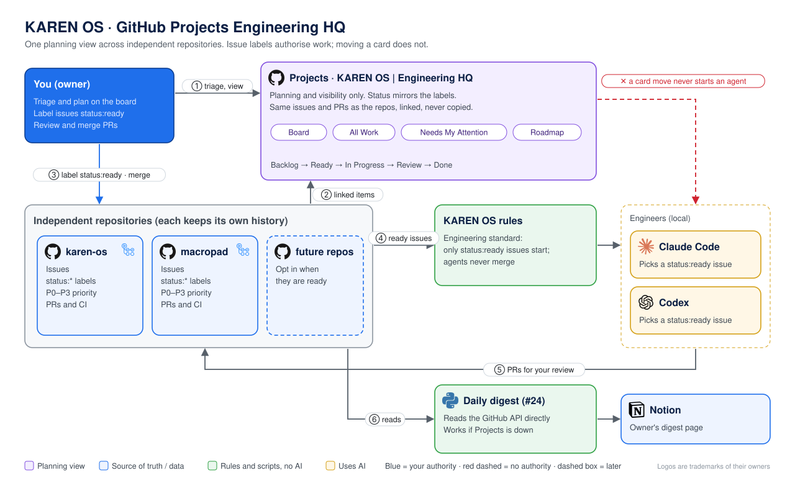

The Project is for planning and visibility. **Moving a card does not authorise work.** Only an issue labelled `status:ready` can be started, and the owner still merges every PR. Direct Claude Code and Codex work, and the planned daily digest, work without the board. The configuration, what was verified and the remaining UI steps are in [the GitHub Projects design](docs/architecture/github-projects.md) ([issue #29](https://github.com/AbhiramYanamandra/karen-os/issues/29)).

## The vision

### Personal first, public second

I am building KAREN OS for myself. It is not a generic framework for hypothetical users. When priorities compete, they rank in this order:

1. Features that improve my actual workflows.
2. My own agent interaction and development preferences.
3. Reliable, supervised autonomous work.
4. Low-friction direct work with Claude Code, Codex and ChatGPT.
5. Efficient use of the AI subscriptions I already pay for.
6. Reusability, but only when it pays off immediately.

The repository is public so that recruiters and other engineers can see the actual work: architecture, decisions, tests and progress, including what doesn't work yet. Open-source generalisation is a later goal. It happens only after a capability has delivered measurable value in my own life.

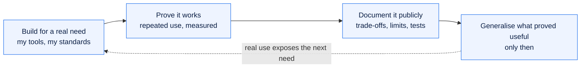

### Two layers that work together

Every capability in KAREN OS has two parts.

| Layer | What it contains | Example from a career workflow |
| --- | --- | --- |
| Reusable mechanics | How a task is scoped, how design approval works, how tests are recorded, how a handoff is written, how an agent checks its permissions | Evidence retrieval, ranking accomplishments, generating a document, a review pass, saving output |
| My operating behaviour | What I prefer, how my projects work, which tools I use, the quality bar I expect, how output should look | My evidence database, my resume template, my cover-letter standards, the job types I want, a preference for fast runs with little unnecessary research |

The mechanics are generic and live here in public. My personal behaviour shapes them. It can be described here in public too, as long as no private records come with it.

## A day with KAREN OS

This section describes the target experience. Most of it is not built yet. [Where it is today](#where-it-is-today) lists exactly what exists.

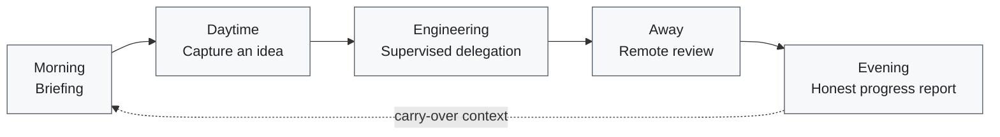

**Morning.** KAREN OS shows my calendar commitments, deadlines, active projects, pending approvals, agent progress and suggested priorities. It separates verified facts from recommendations. If calendar access is unavailable, it says so. It never reports that I have no meetings when it simply couldn't check.

**During the day.** I describe a feature or a product idea. KAREN OS already knows my engineering preferences, existing projects, approved components and architecture standards. It helps me compare options, writes a proposal and shows me what it intends to build before any substantial code exists.

**Engineering.** Once I approve the scope and design, an authorised coding agent works in an isolated branch, runs the relevant tests and prepares a reviewable change. A separate review pass checks the result against my requirements. Merges and releases still need me.

**Away from the desk.** From another device I can capture a request, inspect work, receive selected notifications and approve supported actions. KAREN OS is explicit about what can run remotely and what has to wait for my Mac.

**Evening.** I see what was completed, what is only drafted, what passed verification, what is blocked and what should carry over. Agents leave enough context that tomorrow's session starts without me reconstructing yesterday's conversations.

## Principles

These rules apply to every design decision.

| Principle | What it means in practice |
| --- | --- |
| I am the owner, not the project manager | I set goals, priorities, acceptable risk and budgets. The system handles the operational detail inside the authority I delegate. |
| Direct access always works | I can open Claude Code, Codex or ChatGPT and start working. No agent has to route through another agent. |
| Approval scales with risk, not size | Fixing a typo, redesigning navigation and changing authentication logic get very different treatment, whatever the line count. |
| Design before substantial code | Meaningful UI work starts with a visual proposal. Backend work starts with diagrams, contracts and trade-offs. |
| Never invent status | Unknown stays "unknown". "Merged" and "deployed" are different states. An agent's claim is not evidence of success. |
| Zero additional spend by default | Existing subscriptions first. No silent fallback to a paid API. Extra spending starts at AUD $0 and changes only with my approval. |
| Private data stays private | Personalisation never means committing calendars, messages, credentials, account data or logs to Git. |
| Infrastructure has to earn its place | No dashboards, plugin systems, orchestration layers or monitoring services until a real workflow needs them. |

## How it is organised

KAREN OS is modelled on a small organisation. I am effectively the CEO. The shared operating layer holds the policies, context, task records, handoffs, skills and resource controls. Specialist responsibilities sit underneath it.

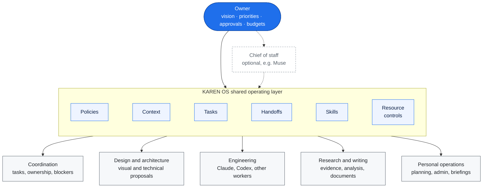

The roles are responsibilities, not six permanently running agents. In practice one Claude Code session might do coordination, design and engineering in a single sitting. The structure decides who is accountable for what. It does not require a process per box.

The chief of staff is optional. Muse is a candidate for capturing tasks, writing briefings and delegating work. KAREN OS is a shared environment, and nothing has to go through a middleman to reach it.

## Entry points

Every tool reaches the same contract and the same records. Today that link is manual, through the files in this repository. Adapters come later, if they prove worth it.

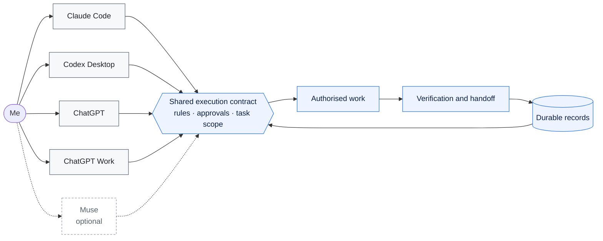

| Route | Status |
| --- | --- |
| Claude Code into this repository | Works today. `CLAUDE.md` imports `AGENTS.md`. |
| Codex into this repository | Works today. Codex reads `AGENTS.md` directly. |
| ChatGPT and ChatGPT Work | Not validated yet. The fallback is a manually prepared context pack. |
| Muse | Optional future integration. Never on the critical path. |

### What happens when an agent opens the repository

This part is implemented and tested. A fresh session gets the same rules and the same verified context whichever tool started it.

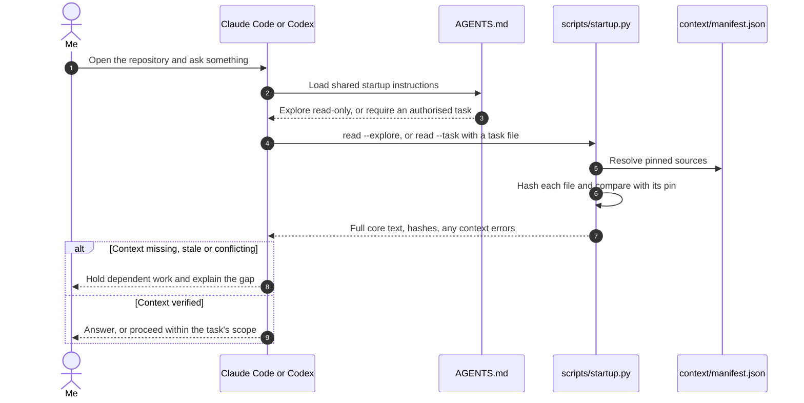

The reader makes no network calls and writes nothing. When a source drifts from its pin, the agent stops and reports it. Pins are never updated automatically. Someone reviews the diff and repins deliberately.

## Working across projects

My projects don't live inside this repository and never will. Macropad, Career Ops, QuantLab, the portfolio site and future projects each keep their own folder, Git history, dependencies, instructions and release cycle. This repository is where the operating system is developed. It works across my projects without containing them.

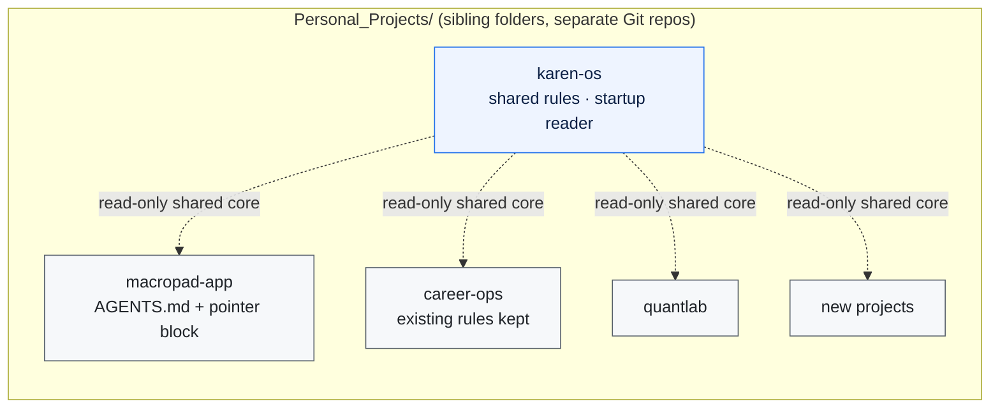

Sitting next to `karen-os` on disk isn't enough on its own. Claude Code reads `CLAUDE.md` files in parent folders and can import files from elsewhere. Codex stops at each project's Git root and has no import syntax, so it never sees anything in `karen-os`. The only mechanism that works in both tools is a short pointer block in each project's own `AGENTS.md`. The block tells the agent to run the KAREN OS startup reader for that project and to follow the shared core it returns.

| Level | What it means | Status |
| --- | --- | --- |
| 1. Casual | Open any project and use Claude Code or Codex normally. Nothing to install. | Works today |
| 2. KAREN-managed | A pointer block and a small `.karen/project.json` make agents load the shared approvals, SOPs and handoff rules inside that project | Proposed, the default goal for projects I use regularly |
| 3. Coordinated | KAREN OS tracks tasks, delegation and status across projects | Future |

A project's existing instructions are kept. They can add restrictions to the shared rules but never remove them. A session inside one project can't read or change any other project. Public projects get no private paths or data. The full design, its security model and its acceptance test are in [docs/architecture/external-projects.md](docs/architecture/external-projects.md).

## Memory

Memory covers more than facts about me. It also records that a design was approved, which revision was approved, which agent worked on a task, what was verified and what is still left.

| Layer | What it holds | Where it lives |
| --- | --- | --- |
| Organisational | Operating principles, engineering methods, SOPs, quality standards, approval rules | This repository |
| Project | Requirements, architecture, decisions, milestones, designs, code references | Each project's repository |
| Operational | Tasks, assignments, blockers, approvals, run states, results, handoffs | Private instance |
| Personal | Preferences, goals, task-relevant personal information | Private instance, with privacy controls |
| Session | Temporary discussion and working notes | The session itself. Selected parts move into durable records. |

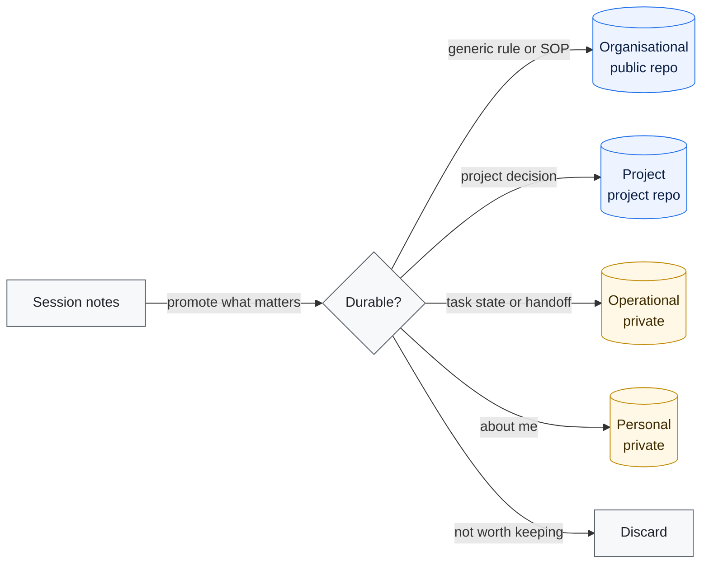

Agents retrieve the context a task needs. They do not load whole histories into every session. That choice serves reliability and also saves tokens.

## Supervised autonomy

KAREN OS uses its own definition of Level 2 supervised autonomy. Agents get enough freedom to be useful. Consequential decisions stay with me.

| Activity | Intended behaviour |
| --- | --- |
| Brainstorming and research | Usually proceeds within granted access |
| Drafts, plans and proposals | Prepared autonomously within scope |
| Small reversible local changes | A documented, authorised fast path |
| Substantial UI or backend changes | Requires an approved, versioned design or architecture proposal |
| Coding and testing | Proceeds within an authorised task |
| Merging, publishing or deploying | Requires my approval |
| Sending messages or contacting anyone | Requires approval of the actual recipient and content |
| Spending or paid fallback | Requires explicit approval |
| Sensitive data or permission changes | Requires explicit scoped authority |
| An external action with an unknown outcome | Check what actually happened before retrying |

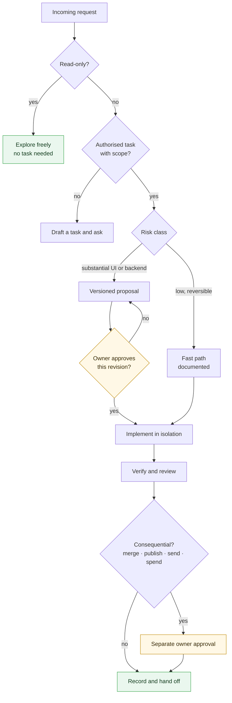

Approval is tied to an exact revision. If the scope, design, permissions or cost change materially, the approval no longer covers the work and it goes back for review.

## The engineering lifecycle

The largest part of KAREN OS is an engineering organisation that can take an idea all the way to a verified, releasable product.

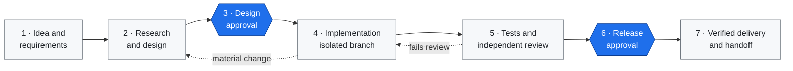

The two blue steps are mine. Everything else can be delegated.

**Design-first is not negotiable.** An agent should not start coding an interface because I described an idea. For meaningful UI work I want to see the proposal first. My taste runs to refined, dense, high-quality interfaces in the spirit of Apple, Apple Music and well-made developer tools. Figma is the preferred editable design environment, and a reviewed browser prototype is the fallback. For backend and infrastructure work, the proposal is an architecture diagram, a data flow, an API contract and the documented trade-offs, with Mermaid kept next to the code. The type of proposal matches the type and risk of the change. A one-line fix doesn't need a mockup.

**A coding agent doesn't approve its own work.** Verification happens on every change, and a separate review pass happens when the risk justifies it. That reviewer may eventually be a different provider. A standing review panel for every small change would burn time and usage without improving the result, so there isn't one.

### The delivery pipeline

The pipeline lives on GitHub and the work happens wherever an agent runs. Every project, KAREN OS included, works the same way:

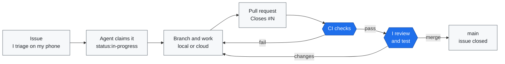

- **Issues are the work queue.** Each one is a task record with an outcome, scope and acceptance criteria. I set the priority (`P0` to `P3`) and mark it `status:ready` when an agent may start.
- **Any agent can pick one up**, on my Mac or in a cloud session. It claims the issue, works on a `<type>/<issue>-<short-description>` branch and opens a pull request with a description, test steps, evidence and anything it couldn't verify.
- **CI is the gate and my merge is the approval.** Agents may push branches and open pull requests. They never merge and never write to `main`. A ruleset on `main` enforces that in every repository.

The rules, adapted from Microsoft's [Code-With Engineering Playbook](https://microsoft.github.io/code-with-engineering-playbook/), are in [docs/organisation/engineering.md](docs/organisation/engineering.md). Templates for labels, issues, pull requests and CI are in [docs/templates/github/](docs/templates/github/). Every project's repository gets the same setup before agents work in it: those labels and templates, a CI workflow, the ruleset on `main`, and automatic deletion of merged branches. The standard lists it as a checklist.

### Handing work between agents

When Claude Code stops partway through a task, because of a usage limit, a closed laptop or my choice, Codex can pick it up from durable records rather than the old conversation.

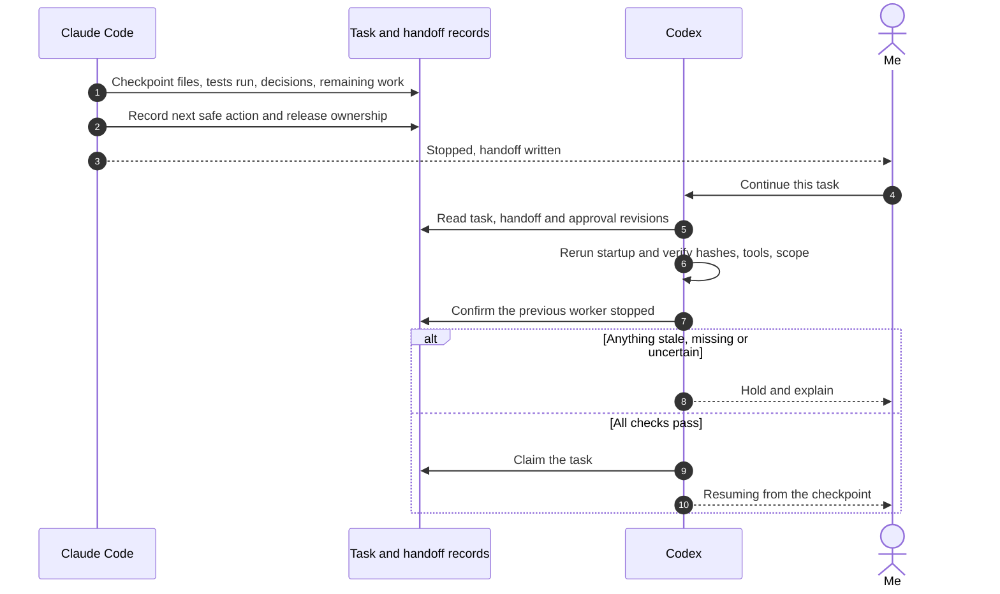

Approvals don't transfer just because a handoff exists. The receiving agent rechecks them. An external action with an unknown result, such as a lost response from a submission, is reconciled before any retry so nothing happens twice.

### Skills and a reusable design system

KAREN OS will keep a curated skills registry. Each entry records its purpose, suitable tasks, required tools, permissions, compatible agents and reviewed version. Agents load only the skills a task needs. They don't load hundreds of instructions or install unreviewed tools. The registry is empty today on purpose.

A shared design system of visual principles, tokens, interaction patterns and tested components will grow out of real projects. It won't start as a speculative component library. Web and native desktop apps can share principles without sharing implementation code.

### The Project Factory

Eventually I should be able to say "I want a desktop app for my Macropad. Help me design it and turn it into a working project." KAREN OS would then run a set process. It clarifies requirements, finds reusable components and templates, recommends an architecture, prepares designs and gets my approval. After that it sets up the repository and project instructions, delegates bounded implementation tasks and verifies the result. This is long-term work. I won't build a scaffolding framework until real projects have shown which conventions deserve reuse.

## Beyond engineering

KAREN OS is meant to be one coherent personal environment, not just a coding tool and not dozens of disconnected agents that each need their own context.

| Area | Intended support | Boundary |
| --- | --- | --- |
| Career | Find and evaluate roles, evidence-backed resumes and cover letters, application tracking, interview prep | Never submits an application automatically |
| Finance and admin | Spending summaries, upcoming expenses, renewals, planning | Starts read-only. Transactions need explicit approval. |
| Fitness and wellbeing | Training plans, progress tracking, routines | Sensitive records stay out of the public repository |
| Learning and research | Learning plans, progress, technical study, reusable notes | Claims are verified before reuse |
| Calendar and messages | Commitments, reminders, draft replies, pending decisions | Sending, booking and editing external records need approval |
| Personal projects | Creative projects, event planning, private experiences | Never contacts anyone without approval |

**Briefings.** A morning briefing and an evening review are the clearest personal wins. The precise schedule, delivery channel and notification rules are still open decisions. Either way the rule doesn't change: missing data shows up as missing, and nothing is made up.

**AI resources.** I want to see how much Claude, Codex and ChatGPT capacity I realistically have and stop wasting it on repetitive work. Some providers don't expose reliable quota data. So every figure is labelled as provider-reported, measured locally, manually observed, estimated or unknown. Deterministic scripts handle work that doesn't need a model. Interactive capacity is kept free for me. Work checkpoints when a quota runs out. A gateway such as OmniRoute is an optional future experiment, not part of the core.

**Remote access.** Capturing tasks, reading project records and approving actions from a phone will probably come before any always-on execution. A sleeping Mac can't run local jobs, and KAREN OS won't pretend otherwise. It also won't expose an unprotected service on my machine for convenience.

## Public repository, private instance

The repository is public, and personalisation is required, but those don't conflict. The line falls between publishable logic and private data.

```mermaid
flowchart LR
    subgraph PUB["Public: github.com/AbhiramYanamandra/karen-os"]
        direction TB
        P1["Execution contract,<br/>policy, SOPs"]
        P2["Context utilities<br/>and tests"]
        P3["Architecture and<br/>roadmap"]
        P4["Publishable descriptions<br/>of my workflows"]
        P5["Synthetic examples"]
    end

    subgraph PRIV["Private instance, outside this tree"]
        direction TB
        Q1["Real tasks, approvals,<br/>handoffs"]
        Q2["Preferences and<br/>memory"]
        Q3["Calendar, messages,<br/>finance, health"]
        Q4["Credentials and<br/>account data"]
        Q5["Runtime logs and<br/>usage observations"]
    end

    PUB -- "pinned platform revision" --> PRIV
    PRIV -. "sanitised bug reports only,<br/>with explicit consent" .-> PUB

    classDef pub fill:#eef4ff,stroke:#1f6feb,color:#0b1f44
    classDef priv fill:#fff8e6,stroke:#bf8700,color:#3d2c00
    class P1,P2,P3,P4,P5 pub
    class Q1,Q2,Q3,Q4,Q5 priv
```

This repository can show how a career workflow works without holding my job applications. It can show how a briefing gets built without holding my calendar. A private repository is not a secret vault either. Sensitive data still needs access controls and consent for each destination.

The earlier development repository is frozen as a private archive. Its code, history and records are never merged in here. [docs/PUBLIC_PRIVATE.md](docs/PUBLIC_PRIVATE.md) has the details.

## Where it is today

The foundation is built. A working personal assistant is not. I'm keeping that distinction explicit.

| Capability | Status |
| --- | --- |
| Owner vision and architecture v0.2 | Documented |
| Shared Claude Code and Codex startup instructions | Implemented and tested locally |
| Hash-pinned context manifest with integrity checks | Implemented |
| Read-only startup reader (`--explore`, `--task` and `--project` modes) | Implemented and tested |
| Missing and conflicting policy detection | Implemented and tested |
| Strict machine receipts and a handoff fixture validator | Implemented and tested |
| Cross-agent manual handoff | Fixture-tested here. Exercised in both directions in the private predecessor, not yet rerun on this checkout. |
| Public GitHub repository, Apache-2.0 | Published |
| Automated CI | GitHub Actions runs every check on each push and pull request, on Python 3.10 and 3.13. The badge above shows the latest result. |
| Engineering standard and issue-to-PR pipeline | Adopted 23 November 2026 in KAREN OS and the Macropad: GitHub issues, pull requests, required CI, protected `main`, owner merge, merged branches deleted automatically |
| ChatGPT and ChatGPT Work context | Not validated |
| Use from other project repositories (Level 2) | Working. The Macropad repository is connected and passed fresh Claude Code and Codex sessions. |
| A real engineering pilot, end to end | In progress in the Macropad. A firmware fix and the first slice of a native Mac app are merged; their pad checks are open issues |
| Private instance location and loader | Not decided, not built |
| Cross-repository planning board (GitHub Projects) | [Engineering HQ](https://github.com/users/AbhiramYanamandra/projects/1) created 23 November 2026 with KAREN OS and Macropad items and four views. New karen-os issues and PRs are added automatically; Macropad items are added by hand (GitHub Free allows one auto-add workflow) |
| Briefings, resource monitor, Project Factory, design system | Planned |
| Autonomous coordination and dispatch | Planned, deliberately last |

The deterministic suite has 57 tests. It uses only Python's standard library and makes no model calls. It runs locally on macOS with Python 3.13, and CI runs it on Linux with Python 3.10 and 3.13. Python 3.10 is the supported minimum. Python 3.9 reached end of life in October 2025, and GitHub no longer provides it on current runners.

### Repository layout

```text
karen-os/
├── .github/
│   ├── workflows/checks.yml          CI: the same checks on every push and pull request
│   ├── pull_request_template.md      What every pull request must say
│   └── ISSUE_TEMPLATE/task.yml       The Task issue form
├── AGENTS.md                         Shared startup entry for every coding agent
├── CLAUDE.md                         Imports AGENTS.md so Claude Code shares it
├── context/
│   ├── manifest.json                 Pinned sources, SHA-256 hashes, read triggers
│   └── receipt-template.json         Format for machine-validation receipts
├── docs/
│   ├── vision.md                     Owner vision and personal-first direction
│   ├── PUBLIC_PRIVATE.md             What lives in public vs the private instance
│   ├── architecture/
│   │   ├── platform-specification.md Full architecture, requirements, ADRs, roadmap
│   │   ├── external-projects.md      Proposal for use from other project repos
│   │   ├── github-projects.md        Cross-repo GitHub Projects board: role, views, limits
│   │   ├── design-status.md          Binds the architecture's exact digest
│   │   └── export-changes.md         Changes made when the public export was created
│   ├── organisation/
│   │   ├── policy.md                 Mandatory core policy, read at every startup
│   │   ├── execution-contract.md     The ten-step agent contract
│   │   ├── sops.md                   Startup, intake, design, verification, handoff
│   │   ├── engineering.md            Issues, branches, commits, PRs, CI, read at every startup
│   │   ├── skills.json               Reviewed skills registry (empty on purpose)
│   │   └── startup-coverage.md       What startup loading does and doesn't prove
│   ├── projects/karen-os/
│   │   └── instructions.md           Project-level instructions, read at startup
│   ├── assets/                       Architecture SVGs and their logo sources (LOGOS.md)
│   ├── templates/records.md          Task, proposal, approval and handoff templates
│   ├── templates/github/             Labels, issue form, PR template, starter CI for projects
│   ├── tasks/startup-validation.md   Synthetic fixture task for validation runs
│   └── reviews/
│       ├── candidate-audit.md        Pre-publication privacy and validation audit
│       └── pilot-macropad.md         First engineering pilot: timeline, measurements, lessons
├── scripts/
│   ├── startup.py                    Reads core and project context, assesses receipts
│   ├── check_context.py              Verifies manifest, hashes and entry files
│   ├── prepare_startup_fixtures.py   Builds isolated read-only probe fixtures
│   └── collect_startup_evidence.py   Extracts startup evidence from agent CLI traces
├── tests/                            57 deterministic tests (context, startup, handoff, projects)
└── examples/instance-config.example.json   Proposed private-instance config shape
```

## Roadmap

The phases describe how capability builds up. They don't make personal usefulness wait until the end. A small daily review can arrive early if it needs no new infrastructure.

```mermaid
flowchart LR
    P1["1 · Architecture"] --> P2["2 · Shared context<br/>and contract"]
    P2 --> P2B["2b · External<br/>project integration"]
    P2B --> P3["3 · Real<br/>engineering pilot"]
    P3 --> P4["4 · Reuse and<br/>Project Factory"]
    P4 --> P5["5 · Chief of staff<br/>integration"]
    P5 --> P6["6 · Personal ops<br/>and resources"]
    P6 --> P7["7 · Advanced<br/>supervised automation"]

    classDef done fill:#eaf7ee,stroke:#2ea043,color:#0f3d1c
    classDef now fill:#1f6feb,stroke:#0b3d91,color:#ffffff
    classDef later fill:#f6f8fa,stroke:#8c959f,color:#57606a
    class P1,P2,P2B done
    class P3 now
    class P4,P5,P6,P7 later
```

| Phase | Goal | Status |
| --- | --- | --- |
| 1 · Architecture | Vision, organisation, responsibilities, autonomy and operating principles | Largely complete. Some decisions remain open. |
| 2 · Shared context and contract | Consistent instructions, permissions, task records and handoffs for every agent | Local foundation complete |
| 2b · External project integration | Independent project repositories load the shared core without moving into this one | Done. The Macropad is connected and passed fresh Claude Code and Codex sessions. Four untested paths are tracked in [#16](https://github.com/AbhiramYanamandra/karen-os/issues/16). |
| 3 · Engineering pilot | Ship one genuinely useful feature through the full approved workflow | In progress in the Macropad. Work is merged and the pad checks are open. See the [pilot log](docs/reviews/pilot-macropad.md); its lessons are issues [#9 to #16](https://github.com/AbhiramYanamandra/karen-os/issues/?q=is%3Aissue+is%3Aopen+label%3Astatus%3Aneeds-owner). |
| 4 · Reuse and Project Factory | Extract proven patterns, components, templates and project setup | Future |
| 5 · Chief of staff | Optional Muse intake, status reporting and delegation | Future |
| 6 · Personal operations | Briefings, personal workflows, supported integrations, usage visibility | Future, with small pieces pulled forward |
| 7 · Advanced automation | Scheduling, dispatch, remote execution, recovery, optional model routing | Future, only with measured benefit |

### Next up

Recently done: KAREN OS adopted the issue-to-PR pipeline and the Macropad followed. Both repositories have required CI, a protected `main` and automatic branch cleanup, and the Macropad's open work is now a prioritised issue queue. The first [pilot log](docs/reviews/pilot-macropad.md) records how it went.

1. **Finish the Macropad pilot.** The pad checks for the firmware fix and the Mac app's first slice are the gate for the next slice.
2. **Feed the lessons back.** Turn the [pilot log](docs/reviews/pilot-macropad.md)'s proposed follow-ups into changes to the standard, the SOPs and the project template, one issue each.
3. **Try a cloud agent.** Have an agent outside this Mac pick up a `status:ready` issue, clone KAREN OS from GitHub and open a pull request, to prove the "from anywhere" path.

### Next personal feature: the daily review

The first pilot ran in the Macropad. The next feature is for my own daily use: a [daily review](https://github.com/AbhiramYanamandra/karen-os/issues/17) that shows, across my repositories, what merged, what's waiting for my review, what's blocked or needs me, what's ready for an agent, and the state of my local checkouts. GitHub issues and pull requests are now the task record, so it needs no private data store. It's read-only, uses only the standard library and costs almost no model usage. It starts with a short proposal for my approval.

### Deliberately deferred

Project Factory automation, design-system extraction, Muse integration, scheduled briefings, remote execution, OmniRoute, dashboards and autonomous dispatch all wait until a real workflow shows they are needed.

## Projects it should support

These real projects anchor the architecture so it isn't built for hypothetical needs. They are candidates, not commitments.

| Project | What it would prove |
| --- | --- |
| Macropad desktop app | Visual design proposal, hardware and software requirements, authorised coding, independent review, desktop delivery |
| Career application workflow | Evidence-backed documents, personal preferences, reliable output quality, lower token and time overhead |
| Portfolio website | Strong visual design, reusable components, verifiable frontend work |
| Personal occasion app | Project Factory, privacy-sensitive assets, approval-controlled communication |
| Research and technical writing | Evidence gathering, claim verification, cross-agent review, versioned drafts |
| QuantLab and larger technical projects | Bounded agents, checkpoints, resource allocation, strict controls on consequential actions |

## What KAREN OS will not become

These limits matter as much as the features. KAREN OS will not become:

- A multi-agent framework that takes months to configure before it does anything useful.
- A mandatory chief-of-staff interface that blocks direct work in Claude or Codex.
- A generic SaaS or multi-tenant product built for hypothetical users.
- A set of always-running agents that burn usage allowances without producing work.
- A system that treats an agent's claim as proof that something happened.
- Copied policies drifting apart across repositories and tools.
- An excuse to build dashboards, plugins or orchestration before they are justified.
- Something that spends money, sends messages, ships software or touches sensitive data beyond what I approved.
- A public repository holding private logs, secrets or personal records.
- A project that spends more time auditing its own architecture than helping me.

The goal is the most useful capability at an acceptable cost, friction and risk. More autonomy, more agents or more complexity are not goals in themselves.

## How success is measured

Success isn't counted in agents, connectors, test files or commits. It is measured by what the system does for me.

| Measure | Question it answers |
| --- | --- |
| Context continuity | Can a fresh session pick up work without me re-explaining? |
| Practical usefulness | Do real projects and personal workflows reach finished outcomes? |
| Time saved | Is there less coordination, repetition and correction? |
| Output quality | Does delivered work match the approved design and requirements? |
| Resource efficiency | Are results per unit of model usage, money and time improving? |
| Trust and control | Zero unauthorised consequential actions, zero silent failures? |
| Portfolio value | Does the public record show careful engineering and real capability? |

## Run it locally

There is nothing to install. The checks need Python 3.10 or newer and use no provider account or network access.

```sh
git clone https://github.com/AbhiramYanamandra/karen-os.git
cd karen-os

python3 -B scripts/check_context.py            # verify every pinned source matches its hash
python3 -B scripts/startup.py read --explore   # print the core context an agent loads
python3 -B -m unittest discover -s tests -v    # run the 53 deterministic tests
```

To work with an agent, open the repository in Claude Code or Codex and ask a question. The agent follows [AGENTS.md](AGENTS.md), loads the core through the startup reader, explains its context, and stays read-only until you give it an authorised task.

A passing hash check proves the files are consistent. It does not prove that anyone approved a change, that an agent read the instructions, or that an action is permitted.

## Documentation map

| If you want to know | Read |
| --- | --- |
| The owner vision and priorities | [docs/vision.md](docs/vision.md) |
| The full architecture, requirements and open decisions | [docs/architecture/platform-specification.md](docs/architecture/platform-specification.md) |
| The rules every agent follows | [docs/organisation/policy.md](docs/organisation/policy.md) |
| The ten-step execution contract | [docs/organisation/execution-contract.md](docs/organisation/execution-contract.md) |
| How tasks, designs, verification and handoffs run | [docs/organisation/sops.md](docs/organisation/sops.md) |
| How issues, branches, pull requests and CI work | [docs/organisation/engineering.md](docs/organisation/engineering.md) |
| What is public and what stays private | [docs/PUBLIC_PRIVATE.md](docs/PUBLIC_PRIVATE.md) |
| How other project repositories use KAREN OS | [docs/architecture/external-projects.md](docs/architecture/external-projects.md) |
| How the public export was reviewed | [docs/reviews/candidate-audit.md](docs/reviews/candidate-audit.md) |
| How the first pilot went | [docs/reviews/pilot-macropad.md](docs/reviews/pilot-macropad.md) |

## Contributing, security and licence

KAREN OS is personal-first and is not accepting outside contributions yet. See [CONTRIBUTING.md](CONTRIBUTING.md). Never put credentials or private information in an issue. See [SECURITY.md](SECURITY.md) for the reporting route.

Licensed under [Apache-2.0](LICENSE). See [LICENSING.md](LICENSING.md) for the reasoning.
