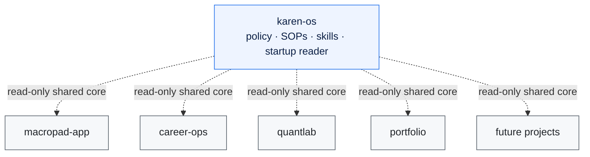
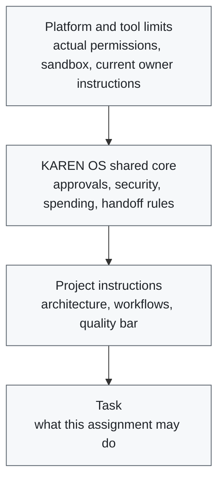
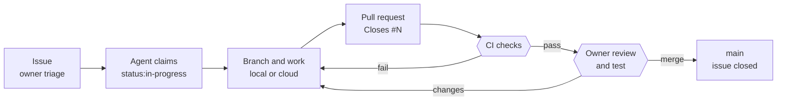

# External project integration

Status: PROPOSED. The owner approved "projects stay independent" on 22 November 2026 and chose to store the `karen-os` location in `.karen/project.json`. Reader support (`startup.py read --project`) is implemented and unit-tested. The first project integration and the native-session tests have not run yet. This document authorises no change to any existing project; each integration needs its own approval of the exact files.

## Decision this proposal rests on

Projects do not live inside the `karen-os` repository and do not become part of its Git history. Each project keeps its own directory, repository, dependencies, instructions and release cycle. The `karen-os` repository is where the operating system is developed. It is not a container for everything else.

KAREN OS works across projects through a small, voluntary integration. Many things it should eventually help with are not Git projects at all, such as applications, calendars and research. A folder layout must never limit what KAREN OS can help with.



Each project is a sibling folder with its own Git repository. Project names are illustrative.

## How the agents find instructions today

Verified against the official documentation on 22 November 2026, with Claude Code 2.1.330 and codex-cli 0.171.0 installed. The acceptance test below must confirm this behaviour in practice.

| Behaviour | Claude Code | Codex |
| --- | --- | --- |
| Automatic project files | `CLAUDE.md` and `CLAUDE.local.md` in the working directory and every directory above it, ordered from the filesystem root down | One `AGENTS.override.md`, `AGENTS.md` or fallback file per directory, from the project root (normally the Git root) down to the working directory |
| Reads above the Git root | Yes | No |
| Global file | `~/.claude/CLAUDE.md` | `~/.codex/AGENTS.md` |
| Import syntax | `@path`, relative or absolute, up to four hops. An import outside the working directory triggers a one-time approval dialog per project. | None |
| Reads `AGENTS.md` | Natively only when no `CLAUDE.md` exists, or by `@AGENTS.md` import | Yes |
| Size limit | Not a fixed limit | `project_doc_max_bytes`, 32 KiB by default |
| Extra directories | `--add-dir` grants file access. It loads that directory's `CLAUDE.md` only with `CLAUDE_CODE_ADDITIONAL_DIRECTORIES_CLAUDE_MD=1`. | `writable_roots` widens write access. Reading outside the workspace under the default sandbox is unverified. |

Two consequences follow. Having `karen-os` next to a project on disk gives Codex nothing. And Claude Code's import is the only automatic cross-repository mechanism, so it cannot be the shared answer for both tools.

## Options compared

| Option | Works in both tools | Main problem | Verdict |
| --- | --- | --- | --- |
| A. `CLAUDE.md` in the shared parent folder | No. Codex stops at the Git root. | It silently applies to every folder under it, including projects that never opted in. | Reject |
| B. Global `~/.claude/CLAUDE.md` and `~/.codex/AGENTS.md` | Yes | It is a global instruction system that applies to every session on the machine, and it was excluded. | Reject |
| C. Copy the policy into each project | Yes | Copies drift apart and become a second editable policy. | Reject |
| D. `@import` of `karen-os` files from each project's `CLAUDE.md` | Claude Code only | Codex gets nothing, and absolute paths leak the machine layout into public repositories. | Use only as a Claude-specific optional addition |
| E. A short pointer block in each project's own `AGENTS.md`, plus the startup reader | Yes | The agent has to run one command, and the reader needs a small extension. | Recommend |

## Recommended mechanism

A Level 2 project gets at most three small additions. Nothing it already has is overwritten.

1. **A pointer block in its existing `AGENTS.md`.** About ten lines, appended under a clear heading. If the project has no `AGENTS.md`, the block becomes the file. If the project only has a `CLAUDE.md`, that file gets `@AGENTS.md` at the top, or the block is placed in `CLAUDE.md` directly.
2. **`CLAUDE.md` containing `@AGENTS.md`,** only when the project has no `CLAUDE.md` yet. Both tools then read the same text.
3. **`.karen/project.json`,** a small public-safe record.

```json
{
  "schema_version": 1,
  "project_id": "macropad",
  "integration_level": 2,
  "karen_os_path": "~/Desktop/Personal_Projects/karen-os",
  "karen_os_repository": "AbhiramYanamandra/karen-os",
  "karen_manifest_revision": "engineering-2",
  "project_instructions": "AGENTS.md",
  "task_location": "plans",
  "pipeline": {
    "tracker": "github",
    "repository": "AbhiramYanamandra/macropad",
    "default_branch": "main"
  }
}
```

| Field | Required | Meaning |
| --- | --- | --- |
| `schema_version` | Yes | Always `1` for now |
| `project_id` | Yes | Short stable name for the project |
| `integration_level` | Yes | `1`, `2` or `3`, as defined below |
| `karen_manifest_revision` | Yes | The KAREN OS manifest revision this project was last checked against |
| `project_instructions` | Yes | The project's own instruction file, relative to the project root |
| `karen_os_path` | No | Where the `karen-os` checkout lives. Agents read it to find the reader. |
| `task_location` | No | The project's existing task or plan folder. The reader lists its Markdown file names, never their contents. |
| `karen_os_repository` | No | GitHub `owner/name` of KAREN OS. A cloud or remote agent without the local checkout clones it from here. |
| `pipeline` | No | Declares the GitHub pipeline from `docs/organisation/engineering.md`: `tracker` (always `github`), `repository` (`owner/name`) and `default_branch`. Declaring it turns on the standard's standing agent authority for this project: push work branches, open pull requests, update issues. Never merge. |

The reader validates these fields and reports them, but makes no network call. Agents use the GitHub CLI or a GitHub connection for issues and pull requests.

Example pointer block, illustrative only:

```markdown
## KAREN OS

This project uses the KAREN OS shared rules. Before acting, read
`karen_os_path` from `.karen/project.json` and run
`python3 -B <karen_os_path>/scripts/startup.py read --project .`
If that path does not exist, as in a cloud session, clone
`karen_os_repository` and run the reader from the clone.
Follow the shared core it returns, including the engineering standard
for issues, branches, commits and pull requests. If the command fails or reports the
project as invalid, say the shared rules are unavailable and do read-only
work only. If it reports stale, tell the owner before acting. Rules in this
file may add restrictions to the shared rules but never remove them. This
session may read only this project and the KAREN OS core, and may not
read or change other projects.
```

### Locating `karen-os`

Owner decision, 22 November 2026: the location goes in `.karen/project.json` as `karen_os_path`, written with `~` so it holds no user name. An environment variable was rejected because macOS desktop apps launched from the Dock often do not load the shell profile, so Codex Desktop or Claude's desktop app could miss it. The costs are that a public project reveals the folder layout `Desktop/Personal_Projects`, and moving `karen-os` means updating each integrated project's record.

### Reader support (implemented)

`python3 -B scripts/startup.py read --project <path>`:

- Returns the shared core (manifest, policy, shared entry) without `docs/projects/karen-os/instructions.md` or the one-line Claude entry, which only make sense inside `karen-os`.
- Reads `<path>/.karen/project.json`, the instruction file it names and the Markdown file names in `task_location`. It reads nothing else from that project.
- Rejects paths, including symlinks, that resolve outside the project.
- Returns `project_status` `ok`, `stale` (pinned revision differs from the current manifest) or `invalid` (missing or malformed record, missing instructions, bad fields), with the reasons listed.
- Stays read-only and network-free, like the rest of the reader.

`tests/test_project.py` covers each of these with a synthetic project and a decoy sibling folder. No service, daemon or registry is involved.

## Precedence and conflicts



Each layer can narrow the one above it. None can widen it.

- A project rule that is stricter than the shared core applies. For example, if Career Ops requires a human review of every generated document, that review happens.
- A project rule that would weaken the shared core, for example "push without asking", does not apply. The agent holds the dependent action and tells the owner about the conflict.
- Project-specific skills, pipelines and conventions stay in the project and keep working unchanged.
- Integration never rewrites existing instruction files. It appends a block, and only after the owner approves the exact diff.

## Integration levels

| Level | What it means | Files in the project | Status |
| --- | --- | --- | --- |
| 1. Casual | Open the project and use Claude Code or Codex normally. Consult KAREN OS by hand when useful. | None | Works today |
| 2. KAREN-managed | Agents load the shared core and follow its approvals, SOPs and handoff conventions inside this project. | Pointer block, optional `CLAUDE.md`, `.karen/project.json` | Proposed. This is the default goal for projects used regularly. |
| 3. Coordinated | KAREN OS tracks tasks, delegation, handoffs and status across projects. | Same as Level 2, plus private-instance task records | Future. Needs infrastructure that does not exist yet. |

## Security

- **Scope.** A session inside a project may read that project and the read-only KAREN OS core. Registering one project gives no access to any other. Agents never edit `karen-os` from another project's session.
- **Public projects.** The pointer block and `.karen/project.json` contain no private paths, credentials, preferences or instance data. Private-instance records are never referenced from a public project.
- **Unreachable core.** If `karen_os_path` is wrong, `karen-os` has moved, or the agent cannot run the reader, the pointer block tells it to report the shared rules as unavailable and stay read-only. It does not guess.
- **Drift.** A pinned revision that no longer matches the manifest is reported as stale. The owner reviews and updates the pin. Nothing repins automatically.
- **Cross-workspace reads.** Both Claude Code and Codex, under their default settings, read `karen-os` from inside the Macropad repository on 22 November 2026. If a future version blocks such reads, the fallback is a per-project `--add-dir` for Claude Code and a reviewed Codex sandbox setting, each needing owner approval.

## Acceptance test

The test uses a synthetic project in a temporary folder outside both `karen-os` and every real project. No existing project is touched.

The synthetic project contains an `AGENTS.md` with:

- one local-only rule, a sentinel the agent must repeat
- one stricter rule than the shared core
- one rule that tries to weaken the shared core
- the pointer block and `.karen/project.json`

| Check | Pass condition |
| --- | --- |
| Core loads in Claude Code | A fresh session runs the reader and reports the KAREN OS manifest revision |
| Core loads in Codex | Same, in a fresh Codex session |
| Local rules preserved | Both sessions repeat the local sentinel and apply the stricter rule |
| No weakening | Both refuse the weakening rule and name the conflict |
| Stale pin | Changing `karen_manifest_revision` makes both report `stale` |
| Missing core | With `karen_os_path` pointing nowhere, both report the shared rules unavailable and stay read-only |
| No cross-project reads | Neither reads a sibling decoy folder |
| Karen-os's own instructions excluded | The reader output omits `docs/projects/karen-os/instructions.md` |

The deterministic parts (reader output, stale pin, missing record, excluded file, path escapes) are already unit tests in `tests/test_project.py`. The native-session parts take about six short sessions across the two tools. They use subscription capacity and need owner approval before they run.

## Relationship to the Project Factory

The Project Factory will create new projects. This integration defines what a KAREN-managed project contains, so the Factory's first output is a project that already passes this acceptance test. Building the Factory waits until a few real projects have used Level 2.

## Roadmap placement

External project integration slots in after the shared context foundation and before the Project Factory. It is the first test of whether KAREN OS works outside its own repository. It also fits the first pilot. An evening review that reads several repositories, or a feature delivered inside a real external project, depends on this integration.

Order: lightweight CI and the reader `--project` extension with unit tests (done locally, not yet pushed), then the first real project, then the native-session checks in Claude Code and Codex. Each step needs its own approval.

## First project

The owner chose the Macropad firmware repository (`rp2040`) on 22 November 2026. When chosen it was local-only with no remote (published as `AbhiramYanamandra/macropad` on 22 November 2026), had no agent instruction files, and already kept numbered plans in `plans/`, which became its `task_location`. It is the easy integration case. The harder case, a project with detailed existing instructions such as Career Ops, waits until this one has proven the design. Career Ops is a public repository, so it gets extra privacy review before any change.

## Delivery pipeline (23 November 2026)

Owner decision D17: GitHub issues are each project's work queue, readable and prioritised from a phone. Any agent, local or cloud, claims a `status:ready` issue, works on a `<type>/<issue>-<short-description>` branch and opens a pull request with `Closes #<issue>`. CI gates the review and the owner's merge is the code approval. Projects opt in with the `pipeline` field and copy the templates in `docs/templates/github/`. The full rules are in `docs/organisation/engineering.md`.



## Decisions

| Decision | Status |
| --- | --- |
| Projects stay independent | Approved, 22 November 2026 |
| How projects locate `karen-os` | `karen_os_path` in `.karen/project.json`, 22 November 2026 |
| Reader `--project` extension | Implemented locally |
| First Level 2 project | Macropad (`rp2040`). Exact files are shown to the owner before they are written. |
| Native-session acceptance tests | Partly passed, 22 November 2026. See results below. |
| Delivery pipeline | GitHub issues, pull requests, CI and owner merge (D17), 23 November 2026 |

## Native-session results (22 November 2026)

The owner ran a fresh session in each tool inside the Macropad repository and asked "What rules apply here, and what are my open plans?"

| Check | Claude Code 2.1.330 | Codex 0.171.0 |
| --- | --- | --- |
| Found the pointer and ran the reader | Yes | Yes. It read `.karen/project.json` first, then ran the reader with the expanded path. |
| Reader status | `ok`, revision `personal-first-1` | `ok`, revision `personal-first-1` |
| Kept the local rule (this project and the KAREN OS core only) | Yes | Yes |
| Reported plans correctly | Yes. 007 is the only TODO; 003 to 006 await device checks. | Yes, the same |
| Read `karen-os` from inside another workspace | Yes | Yes. This settles the unverified sandbox-read question for the default Codex sandbox. |

Not yet exercised natively: the stale pin, the unreachable core, refusing a weakening rule, and the decoy sibling. The unit tests cover the reader side of each. Claude Code's first attempt was held by the owner's own global pre-command hook until the session stated its purpose. That hook is local machine configuration, not part of KAREN OS.
