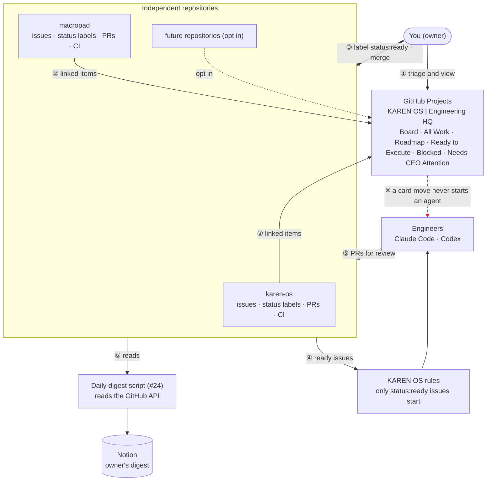
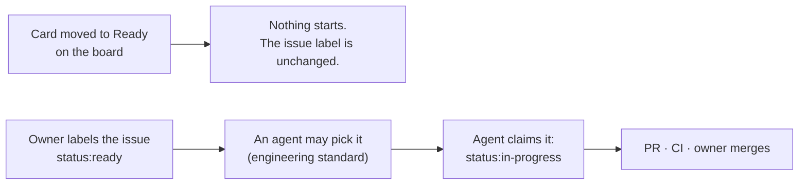

# GitHub Projects: Engineering HQ

**Status:** created and configured. [KAREN OS | Engineering HQ](https://github.com/users/AbhiramYanamandra/projects/1) is a public Project on the owner's personal GitHub account. Its views, items and workflows were checked on 23 November 2026, including the owner's UI steps. Tracking: [issue #29](https://github.com/AbhiramYanamandra/karen-os/issues/29).

## What it is for

The Project is one place to see engineering work across independent repositories. It started with [karen-os](https://github.com/AbhiramYanamandra/karen-os) and [macropad](https://github.com/AbhiramYanamandra/macropad). Each issue and pull request stays in its own repository; the Project links to it and never copies it. Other repositories join only when the owner adds them, tracked in [#31](https://github.com/AbhiramYanamandra/karen-os/issues/31).

**Connected repositories** (23 November 2026):

| Repository | On the board | Engineering standard setup |
| --- | --- | --- |
| karen-os | Yes; new items added automatically | Complete |
| macropad | Yes; new items added by hand (Free allows one auto-add workflow) | Complete |
| LookAtMe | Yes; new items added by hand | Complete: labels, templates, CI, `protect-main` ruleset, auto-delete, `.karen/project.json` |
| QuantLabs | Nothing to show yet (empty repository) | Labels and auto-delete only; the rest when its first code lands |
| wya (`aveturi14/wya`) | Not yet | Waiting for its owner's agreement |

KAIRA and career-ops-panel are deliberately left out (owner decision, #31).

It is a planning and visibility layer. It is not a task store and it is not a permission.

| System | What it is the authority for |
| --- | --- |
| Repository issues and labels | The task, its `status:*` execution state and its `P0`–`P3` priority |
| Pull requests, CI and the `main` ruleset | Proposed changes, evidence and owner-controlled merging |
| GitHub Projects | Nothing. It shows, groups and plans the items above |
| KAREN OS | Rules, approvals, context and dispatch |
| Notion (daily review, [epic #17](https://github.com/AbhiramYanamandra/karen-os/issues/17)) | The owner's personal goals and plans; engineering entries link back to GitHub |

**Moving a card does not authorise work.** Changing a card's Status, adding an item or reordering the board never lets a coding agent start. Only an issue labelled `status:ready`, under the [engineering standard](../organisation/engineering.md), can be started. When a card's Status and its issue's label disagree, the label is right and the card is stale.

## Architecture (editable source)

The SVG above is the presentation copy. These Mermaid diagrams are the editable source and say the same thing.

What happens when a card moves:

The digest (#24) reads issues, labels and PRs straight from the GitHub API, so it keeps working if the Project is unavailable. It may later read the Project for ordering, but never depends on it.

## Configuration (verified 23 November 2026)

**Location and visibility.** Personal account `AbhiramYanamandra`, Project number 1, public. Both source repositories are public too, so the board shows nothing that isn't already visible. Private repositories are not added.

**Fields.** GitHub's built-in fields (Title, Assignees, Status, Labels, Linked pull requests, Milestone, Repository, Reviewers, Parent issue, Sub-issues progress, Created, Updated, Closed) plus three added fields:

- **Workstream** (single select), added by [#52](https://github.com/AbhiramYanamandra/karen-os/issues/52). See "Workstreams and epics" below.
- **Start date** and **Target date** (dates). The Roadmap uses them for the start and end of each bar; GitHub needs two different fields for that. Both stay empty until the owner agrees dates. There is no Project priority field: `P0`–`P3` labels stay the only priority.

**Status options.** Status is presentation only, set from the issue's label:

| Status | Shown for |
| --- | --- |
| Backlog | `status:needs-owner`, `status:blocked`, or no status label |
| Ready | `status:ready` |
| In Progress | `status:in-progress`, or a draft PR |
| Review | `status:in-review`, or a PR ready for review |
| Done | Closed issues and merged PRs |

The original Todo, In Progress and Done options were kept and renamed where needed, so the built-in workflows still point at the right options (Todo became Backlog).

**Workstreams and epics** (24 November 2026, #52). *Workstream* says what kind of organisational work an item is. The built-in **Repository** field says where it lives, so the two never overlap. A Macropad feature is Product Delivery in `macropad`, and connecting a new repository is Project Integrations in `karen-os`. Workstream is set at triage, and an empty value shows as its own group. Like Status, it never authorises work.

| Workstream | Use for |
| --- | --- |
| Engineering Organisation | Company standards, skills, lifecycle profiles, enforcement (epic #43) |
| Personal Operations | The owner's daily review and personal tools (epic #17) |
| Platform Infrastructure | KAREN OS runtime code: startup, pipeline, digest, checks |
| Process Improvements | Changes to how work is done, from lessons and retrospectives |
| Project Integrations | Connecting a repository to KAREN OS and Engineering HQ |
| Product Delivery | Features, fixes and tests inside a product repository (Macropad, LookAtMe and future products) |

**Epic rule.** An epic carries a `status:*` label only when it needs an owner decision itself. Its open decisions otherwise live in its sub-issues, so the epic shows on the Roadmap but not in Needs CEO Attention. With no status label, it shows as Backlog and can never be picked up as work. Its sub-issues and native "blocked by" links show order and progress.

**Views.** Each answers one question (#52). Views can only be created and edited in GitHub's UI. The steps are under "Owner steps in the GitHub UI".

| View | Answers | Layout | Filter | Group by |
| --- | --- | --- | --- | --- |
| Roadmap | Company initiatives | Roadmap | `is:open no:parent-issue` | Workstream |
| Ready to Execute | Work an engineer may pick up or is doing | Table: Title, Repository, Labels, Status, Linked PRs, Parent issue | `is:open label:"status:ready","status:in-progress"` | Workstream |
| Blocked | Blocked tasks | Table: Title, Repository, Labels, Parent issue, Linked PRs, Updated | `is:open label:"status:blocked"` | Workstream |
| Needs CEO Attention | Decisions and reviews waiting on the owner | Table: Title, Repository, Labels, Status, Linked PRs, Updated | `is:open label:"status:needs-owner","status:in-review"` | Workstream |
| Board | Everything by Status | Board, columns by Status | none | — |
| All Work | Everything | Table: as before, plus Workstream | none | — |

Before #52, the attention view was called Needs My Attention and also included `status:blocked`. On 23 November it held 26 items (20 rows plus 6 sub-issues under #17), and the Roadmap held 22 top-level issues.

**Limits of the attention view.**

- Projects filters can't combine "is a PR" with "has a label" as an OR, and the repositories don't label PRs. So a PR waiting for review shows up through its issue, which the engineering standard moves to `status:in-review` when the PR is marked ready. The Linked PRs column links to it.
- Projects can't filter on CI results. Failed checks are on each repository's Actions tab, and the digest (#24) will list them with links.

**Items.** All 28 open issues and both open PRs from the two repositories were added once each with `gh project item-add`: 20 from karen-os and 10 from macropad. Each item's Status was then set once from its label. No labels were changed.

## How Status stays in step

Labels change as work moves. The board does not follow them by itself:

- GitHub's built-in workflows only react to closing, merging, linking and adding items.
- Mirroring labels automatically would need a token-bearing GitHub Action, which issue #29 rules out.

So:

1. Whoever changes an issue's `status:*` label also moves its card. That is the owner, or the agent doing the claim, ready or cleanup step.
2. The pipeline script ([#21](https://github.com/AbhiramYanamandra/karen-os/issues/21)) is the natural place to do this automatically: one-way, label to Status, with the owner's local `gh` login. This is a proposal for #21, not something built yet.
3. If they disagree, the label wins and the card is fixed.

## Built-in workflows

GitHub created six workflows with the Project, all enabled. The API can list and delete them but can't switch them on or off, so changes are made in the UI. The settings below were read in the signed-in UI on 23 November 2026.

| Workflow | What it does | Decision |
| --- | --- | --- |
| Item added to project | Issues and PRs: sets Status to Backlog | On. Project only |
| Item closed | Sets Status to Done | On. Project only |
| Pull request merged | Sets Status to Done | On. Project only |
| Pull request linked to issue | Sets the issue's Status to In Progress when a PR is linked | On. Project only |
| Auto-add sub-issues to project | Adds an item's sub-issues to the Project | On. No labels or states touched |
| **Auto-close issue** | **Would close the issue when its card's Status is set to Done** | **Off** (turned off by the owner). A card move must not change the real issue. Issues close when the owner merges a PR with `Closes #n`. |
| **Auto-add to project** | Adds new or updated items from `karen-os` matching `is:issue,pr is:open` | **On** (set up by the owner) |

Auto-archive items, Code changes requested, Code review approved and Item reopened stay off.

**Auto-add.** GitHub can add new issues and PRs from a repository automatically. Three limits from [GitHub's documentation](https://docs.github.com/en/issues/planning-and-tracking-with-projects/automating-your-project/adding-items-automatically) apply:

- Each auto-add workflow watches one repository, and a GitHub Free account gets one auto-add workflow per Project (Pro gets five). The owner's account is on Free.
- It only adds items created or updated after it is switched on. That is why the existing items were added by hand.
- It can't be created through the API.

Configured on Free: one auto-add workflow for `karen-os` with filter `is:issue,pr is:open` (verified). New Macropad items are added with `gh project item-add`, from the issue's Projects sidebar, or later by #21's script. Auto-add only adds cards. It never changes labels or authorises work.

## Owner steps in the GitHub UI

**Views for #52** (GitHub's API can't create or edit views). In the Project, for each view, set the filter in the filter bar, choose **Group by → Workstream** from the view menu, then **Save view** and confirm **Save**. Using "Save changes to new view" instead creates an extra tab.

1. **Needs My Attention:** rename it to **Needs CEO Attention** (double-click the tab name). Set the filter to `is:open label:"status:needs-owner","status:in-review"`. Group by Workstream. Save.
2. **Roadmap:** set the filter to `is:open no:parent-issue`. Group by Workstream. Save.
3. **Ready to Execute:** choose **+ New view → Table** and name it. Set the filter to `is:open label:"status:ready","status:in-progress"`. Show Title, Repository, Labels, Status, Linked PRs and Parent issue. Group by Workstream. Save.
4. **Blocked:** choose **+ New view → Table** and name it. Set the filter to `is:open label:"status:blocked"`. Show Title, Repository, Labels, Parent issue, Linked PRs and Updated. Group by Workstream. Save.
5. **All Work:** add the Workstream column. Save.

**Earlier steps (done):**

These had to be done in GitHub's web UI because the API has no mutation for them. All were checked in the signed-in UI on 23 November 2026.

1. **Auto-close issue** is off.
2. **Auto-add to project** is on for `karen-os` with filter `is:issue,pr is:open`. The account is on Free, so `macropad` has no auto-add workflow.
3. **Roadmap date fields** are Start date and Target date, saved as the view default. Saving needs the view's **View → Save view** button and then **Save** in the confirmation dialog. "Save changes to new view" in the tab menu creates an extra tab instead.

Auto-add only adds items created or updated after it was switched on. Verified: karen-os issue #31, filed on 23 November 2026, was added automatically and set to Backlog.

## Other GitHub features reviewed

| Feature | Decision | Why |
| --- | --- | --- |
| Sub-issues | **In use** | Epic #17 already holds #23–#28 as sub-issues; the Project shows them nested and "Auto-add sub-issues" keeps them on the board |
| Issue dependencies (blocked by) | **Adopted, one link** | #26 is now natively "blocked by #21", which was previously only written in prose. No labels changed. Add more only where a real dependency exists |
| Built-in Project workflows | **Keep five, turn off Auto-close** | See above |
| Saved views and filters | **Adopted** | The four views are the saved filters; no separate searches needed |
| Milestones | **Not now** | Neither repository has milestones and no dates are agreed. Use one when the owner sets a dated release goal |
| Branch rulesets | **Keep as is** | `protect-main` is active on karen-os; no change made |
| Secret scanning and push protection | **Already on** | Enabled on both repositories; no change made |
| Dependabot alerts and version updates | **Recommend, separate review** | Off on both. karen-os uses only the Python standard library, so the real value is keeping GitHub Actions versions current. Turning it on is a security setting and opens bot PRs, so it needs its own issue |
| Code scanning (CodeQL) | **Recommend, separate review** | Free for public repositories, but adds a workflow with extra permissions. Needs its own issue |
| Releases and generated notes | **Later** | Nothing is versioned yet. Useful once something ships to users |
| GitHub Actions to sync the board | **Rejected** | Needs a token with Projects write access; issue #29 rules it out |

## Logos

The SVG embeds real product logos inline, because GitHub's Mermaid can't show images. Sources and licences are in [docs/assets/LOGOS.md](../assets/LOGOS.md).

## Acceptance

- [x] Owner-owned Project exists: <https://github.com/users/AbhiramYanamandra/projects/1>.
- [x] Issues and PRs from both repositories appear; the repositories are unchanged.
- [x] Board, All Work, Needs My Attention and Roadmap work. Roadmap bars appear once an item has agreed dates.
- [x] Card moves don't authorise work: stated here, on the Project's readme, in the engineering standard and in the diagrams.
- [x] The digest design (#24) reads GitHub directly and doesn't depend on the Project.
- [x] No paid plan, personal access token, new secret or new Action.
- [x] Owner UI steps done and checked.
