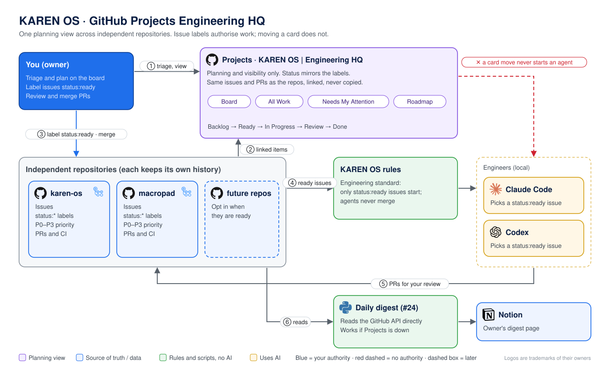
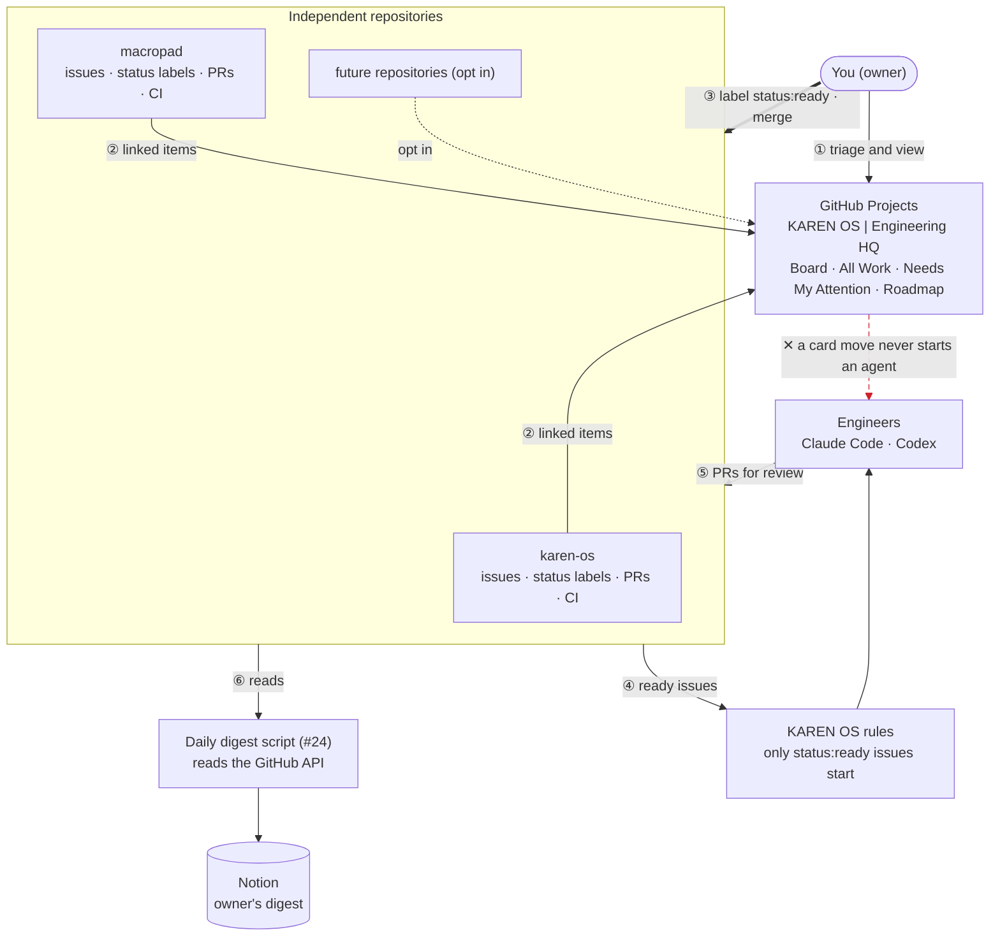
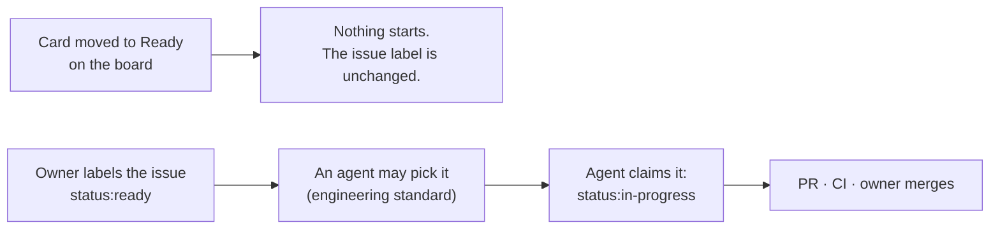

# GitHub Projects: Engineering HQ

**Status:** created and configured. [KAREN OS | Engineering HQ](https://github.com/users/AbhiramYanamandra/projects/1) is a public Project on the owner's personal GitHub account. Its views and items were checked on 23 November 2026. Two workflow changes, listed under [Owner steps in the GitHub UI](#owner-steps-in-the-github-ui), still need the owner. Tracking: [issue #29](https://github.com/AbhiramYanamandra/karen-os/issues/29).

## What it is for

The Project is one place to see engineering work across independent repositories. It starts with [karen-os](https://github.com/AbhiramYanamandra/karen-os) and [macropad](https://github.com/AbhiramYanamandra/macropad). Each issue and pull request stays in its own repository; the Project links to it and never copies it. Other repositories join only when the owner adds them.

It is a planning and visibility layer. It is not a task store and it is not a permission.

| System | What it is the authority for |
| --- | --- |
| Repository issues and labels | The task, its `status:*` execution state and its `P0`–`P3` priority |
| Pull requests, CI and the `main` ruleset | Proposed changes, evidence and owner-controlled merging |
| GitHub Projects | Nothing. It shows, groups and plans the items above |
| KAREN OS | Rules, approvals, context and dispatch |
| Notion (daily review, [epic #17](https://github.com/AbhiramYanamandra/karen-os/issues/17)) | The owner's personal goals and plans; engineering entries link back to GitHub |

**Moving a card does not authorise work.** Changing a card's Status, adding an item or reordering the board never lets a coding agent start. Only an issue labelled `status:ready`, under the [engineering standard](../organisation/engineering.md), can be started. When a card's Status and its issue's label disagree, the label is right and the card is stale.

## Architecture (editable source)

The SVG above is the presentation copy. These Mermaid diagrams are the editable source and say the same thing.

What happens when a card moves:

The digest (#24) reads issues, labels and PRs straight from the GitHub API, so it keeps working if the Project is unavailable. It may later read the Project for ordering, but never depends on it.

## Configuration (verified 23 November 2026)

**Location and visibility.** Personal account `AbhiramYanamandra`, Project number 1, public. Both source repositories are public too, so the board shows nothing that isn't already visible. Private repositories are not added.

**Fields.** GitHub's built-in fields (Title, Assignees, Status, Labels, Linked pull requests, Milestone, Repository, Reviewers, Parent issue, Sub-issues progress, Created, Updated, Closed) plus one added field:

- **Target date** (date). It is used by the Roadmap and stays empty until the owner agrees a date. There is no Project priority field: `P0`–`P3` labels stay the only priority.

**Status options.** Status is presentation only, set from the issue's label:

| Status | Shown for |
| --- | --- |
| Backlog | `status:needs-owner`, `status:blocked`, or no status label |
| Ready | `status:ready` |
| In Progress | `status:in-progress`, or a draft PR |
| Review | `status:in-review`, or a PR ready for review |
| Done | Closed issues and merged PRs |

The original Todo, In Progress and Done options were kept and renamed where needed, so the built-in workflows still point at the right options (Todo became Backlog).

**Views.**

| View | Layout | Filter | Checked |
| --- | --- | --- | --- |
| Board | Board, columns by Status | none | 25 Backlog, 2 Ready, 1 In Progress, 2 Review |
| All Work | Table: Title, Repository, Status, Labels, Assignees, Linked PRs, Parent issue, Milestone, Target date, Updated | none | 30 items from both repositories |
| Needs My Attention | Table: Title, Repository, Labels, Status, Linked PRs, Updated | `is:open label:"status:needs-owner","status:blocked","status:in-review"` | 26 items (20 rows plus 6 sub-issues under #17) |
| Roadmap | Roadmap | `is:issue no:parent-issue` | 22 top-level issues; no bars until a Target date is set |

**Limits of the attention view.**

- Projects filters can't combine "is a PR" with "has a label" as an OR, and the repositories don't label PRs. So a PR waiting for review shows up through its issue, which the engineering standard moves to `status:in-review` when the PR is marked ready. The Linked PRs column links to it.
- Projects can't filter on CI results. Failed checks are on each repository's Actions tab, and the digest (#24) will list them with links.

**Items.** All 28 open issues and both open PRs from the two repositories were added once each with `gh project item-add`: 20 from karen-os and 10 from macropad. Each item's Status was then set once from its label. No labels were changed.

## How Status stays in step

Labels change as work moves. The board does not follow them by itself:

- GitHub's built-in workflows only react to closing, merging, linking and adding items.
- Mirroring labels automatically would need a token-bearing GitHub Action, which issue #29 rules out.

So:

1. Whoever changes an issue's `status:*` label also moves its card. That is the owner, or the agent doing the claim, ready or cleanup step.
2. The pipeline script ([#21](https://github.com/AbhiramYanamandra/karen-os/issues/21)) is the natural place to do this automatically: one-way, label to Status, with the owner's local `gh` login. This is a proposal for #21, not something built yet.
3. If they disagree, the label wins and the card is fixed.

## Built-in workflows

GitHub created six workflows with the Project, all enabled. The API can list and delete them but can't switch them on or off, so changes are made in the UI.

| Workflow | What it does | Decision |
| --- | --- | --- |
| Item added to project | Sets Status to Backlog (formerly Todo) | Keep: Project only |
| Item closed | Sets Status to Done | Keep: Project only |
| Pull request merged | Sets Status to Done | Keep: Project only |
| Pull request linked to issue | Sets the Project Status when a PR is linked | Keep: Project only |
| Auto-add sub-issues to project | Adds an item's sub-issues to the Project | Keep: no labels or states touched |
| **Auto-close issue** | **Closes the issue when its card's Status is set to Done** | **Turn off** (owner step). It lets a card move change the real issue. Issues close when the owner merges a PR with `Closes #n`. |

**Auto-add.** GitHub can add new issues and PRs from a repository automatically. Three limits from [GitHub's documentation](https://docs.github.com/en/issues/planning-and-tracking-with-projects/automating-your-project/adding-items-automatically) apply:

- Each auto-add workflow watches one repository, and a GitHub Free account gets one auto-add workflow per Project (Pro gets five).
- It only adds items created or updated after it is switched on. That is why the existing items were added by hand.
- It can't be created through the API.

Recommended setup on Free: one auto-add workflow for `karen-os` with filter `is:issue,pr is:open`. Macropad items are added with `gh project item-add` (or by #21's script) until the plan allows a second workflow. Auto-add only adds cards. It never changes labels or authorises work.

## Owner steps in the GitHub UI

These need the owner signed in to GitHub. Agent tools can't do them: the API has no mutation for them, and the agent's browser is not signed in.

1. **Workflows → Auto-close issue → turn off.**
2. **Workflows → Auto-add to project → karen-os, filter `is:issue,pr is:open` → turn on.** If the account is on Pro, duplicate it for `macropad`.
3. **Roadmap view → Date fields → choose Target date** for both start and target, then save the view.
4. Optional: drag **Board** to be the first view tab, so it opens on phones by default.

Until these are done, this document does not claim auto-add or the Roadmap bars work.

## Other GitHub features reviewed

| Feature | Decision | Why |
| --- | --- | --- |
| Sub-issues | **In use** | Epic #17 already holds #23–#28 as sub-issues; the Project shows them nested and "Auto-add sub-issues" keeps them on the board |
| Issue dependencies (blocked by) | **Adopted, one link** | #26 is now natively "blocked by #21", which was previously only written in prose. No labels changed. Add more only where a real dependency exists |
| Built-in Project workflows | **Keep five, turn off Auto-close** | See above |
| Saved views and filters | **Adopted** | The four views are the saved filters; no separate searches needed |
| Milestones | **Not now** | Neither repository has milestones and no dates are agreed. Use one when the owner sets a dated release goal |
| Branch rulesets | **Keep as is** | `protect-main` is active on karen-os; no change made |
| Secret scanning and push protection | **Already on** | Enabled on both repositories; no change made |
| Dependabot alerts and version updates | **Recommend, separate review** | Off on both. karen-os uses only the Python standard library, so the real value is keeping GitHub Actions versions current. Turning it on is a security setting and opens bot PRs, so it needs its own issue |
| Code scanning (CodeQL) | **Recommend, separate review** | Free for public repositories, but adds a workflow with extra permissions. Needs its own issue |
| Releases and generated notes | **Later** | Nothing is versioned yet. Useful once something ships to users |
| GitHub Actions to sync the board | **Rejected** | Needs a token with Projects write access; issue #29 rules it out |

## Logos

The SVG embeds real product logos inline, because GitHub's Mermaid can't show images. Sources and licences are in [docs/assets/LOGOS.md](../assets/LOGOS.md).

## Acceptance

- [x] Owner-owned Project exists: <https://github.com/users/AbhiramYanamandra/projects/1>.
- [x] Issues and PRs from both repositories appear; the repositories are unchanged.
- [x] Board, All Work and Needs My Attention work; Roadmap filters work but needs owner step 3 for bars.
- [x] Card moves don't authorise work: stated here, on the Project's readme, in the engineering standard and in the diagrams.
- [x] The digest design (#24) reads GitHub directly and doesn't depend on the Project.
- [x] No paid plan, personal access token, new secret or new Action.
- [ ] Owner steps 1–3 done and checked.
