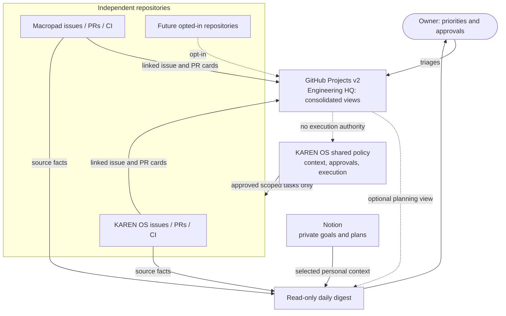

# GitHub Projects: Engineering HQ

**Status:** proposed configuration, not provisioned. Tracking: [KAREN OS #29](https://github.com/AbhiramYanamandra/karen-os/issues/29). This document records the agreed cross-repository use of GitHub Projects without claiming a board already exists. The user-owned Project URL and actual field IDs must be added **after** successful creation and verification.

## Purpose and boundaries

KAREN OS is personal-first. A single account-level GitHub Project, **KAREN OS | Engineering HQ**, should display work across independent repositories, starting with [karen-os](https://github.com/AbhiramYanamandra/karen-os) and [macropad](https://github.com/AbhiramYanamandra/macropad). Other repos opt in as needed; nothing is moved into the KAREN OS Git history. The board is optional: coding agents and the read-only digest remain usable if it is unavailable.

| System | Canonical responsibility |
| --- | --- |
| Repository issues and labels | Specific engineering tasks, `status:*` execution gate, `P0`–`P3` priority |
| Pull requests / checks / branch rules | Proposed changes, CI evidence, owner-controlled merging |
| GitHub Projects | Cross-repository **view**, grouping, triage and optional target dates |
| KAREN OS | Rules, authorisation, project context, task dispatch and evidence |
| Notion (private) | Personal goals, day plans and selected digests; engineering entries link to GitHub |
| Composio (optional) | Restricted external app tools, not an approval or task authority |

Do **not** create duplicate issues or copy GitHub status into an independently editable Project/Notion state. Moving a Project card, changing its `Status` field, or merely adding an item never confers execution authority; readiness still requires a correctly authorised `status:ready` issue and valid owner directions. A Project's inferred progress is not verified delivery.

## Architecture (editable source)

Use Mermaid as the maintained source. A polished logo-bearing visual may accompany it for presentations, using verified icon licenses and source attribution. The existing [daily-review architecture SVG](https://github.com/AbhiramYanamandra/karen-os/blob/docs/17-daily-review-proposal/docs/assets/daily-review-architecture.svg) includes product branding and should be reconciled in PR #20. Do not pretend GitHub Mermaid embeds external logo images reliably.

## Initial configuration (one project only)

- **Location:** personal GitHub account `AbhiramYanamandra`, rather than inside one repository.
- **Project name:** `KAREN OS | Engineering HQ`.
- **Visibility:** choose deliberately before creation. Public improves portfolio transparency but exposes issue titles and planning context; private is safer for personal planning. Start with *public engineering-only items* and no personal records, after reviewing the actual visibility setting.
- **Sources:** the existing KAREN OS and Macropad issues and PRs; omit unrelated private repositories by default.
- **Board:** Backlog, Ready, In Progress, Review, Done. GitHub Project Status is a **presentation field**, not a new `status:*` execution label.
- **Table:** All work. Show repository, title, assignees, labels, status and optional dates. Avoid a duplicate manually maintained priority field.
- **Needs My Attention:** save a filtered view for PRs requiring review, `status:needs-owner`, `status:blocked` and associated owner-facing work. GitHub CI failure is not necessarily natively filterable through Projects; display that from the digest with direct checks links instead.
- **Roadmap:** view for issues or initiatives with genuine agreed dates. Don't invent due dates.
- **Automatic addition:** prefer GitHub Projects built-in auto-add workflows for matching repositories, where available. Test filters and quota/plan constraints first. Do not use new PATs or privileged GitHub Actions just for synchronisation.
- **Automation:** do not initially make bidirectional status/label changes. Confirm the actual Project built-in workflow effects before enabling anything that changes issues.

### Provisioning and verification

GitHub's Projects v2 management API is GraphQL and requires the appropriate account-level project scope/permission; repository Issues write access alone is insufficient. If the current integration cannot create/edit a Project, create it through GitHub UI or an explicitly authorised `gh project` session. **Do not infer the Project URL or ID.**

Manual UI setup sequence after checking account capabilities:

1. Open the GitHub profile's **Projects** section and create a **New project**.
2. Set title `KAREN OS | Engineering HQ`, inspect visibility and decide to make it public or private.
3. Add selected KAREN OS and Macropad issues/PRs; validate links still point to their original repositories.
4. Configure the four views above and the minimal Status field.
5. Try one read-only daily review and confirm no status or permission drift.
6. Record the actual Project URL/ID here and in the corresponding epic/README after verification.

Do not force a board migration of existing tasks. If automation scope is unavailable, manual item addition is the safe starting point.

## Adjacent GitHub features reviewed

| Feature | Recommendation | Why |
| --- | --- | --- |
| GitHub Issues + sub-issues / dependencies | **Evaluate for epic #17 and future work** | Native grouping can reduce duplicate epic checklists; don't break existing cross-links or assume a given account has the feature |
| Pull request template + required CI | **Keep** | Already implemented; source of reviewable delivery and checks |
| Branch rulesets / owner merge | **Keep** | Protect `main` and preserve approval boundary |
| Built-in Project workflows | **Trial minimal auto-add** | Less custom syncing, but inspect side effects and plan limits first |
| Saved searches / filters | **Use for owner attention** | Quick view without writing scripts |
| Milestones | **Use selectively** | Meaningful release goals, not every personal task |
| Releases / release notes | **Later, on actual shipped functionality** | Good portfolio evidence once versioned delivery exists |
| Code scanning / Dependabot / secret scanning | **Review availability and signal** | Security value, but avoid noisy or privileged configurations; no reason to claim enabled |
| Issue forms / custom issue fields | **Keep templates; prefer current labels** | Standard tasks and clear ownership; avoid duplicate fields |
| GitHub Actions for project synchronisation | **Defer** | Requires tokens/scopes; built-in features and manual board are sufficient initially |

## Acceptance and safeguards

- [ ] Actual user-owned Projects board created and URL verified.
- [ ] Selected issues/PRs from **both** initial repositories appear; repositories remain separate.
- [ ] Board, Table, Needs My Attention and Roadmap views work and do not duplicate mutable task state.
- [ ] Project Status is clearly non-authoritative for execution.
- [ ] A read-only digest works even if Projects is inaccessible.
- [ ] No private details, secrets, new paid services or unreviewed GitHub tokens.
- [ ] Link and diagram changes in PR #20, epic #17 and README reflect verified status rather than planned status.
- [ ] Only adopt other GitHub tools after a specific workflow demonstrates benefit.

**Implementation status:** Documentation and repo review can proceed via a separate PR. Actual Project creation/configuration requires a capable authenticated GitHub Projects integration or owner UI session; this document is not evidence that the Project exists.
