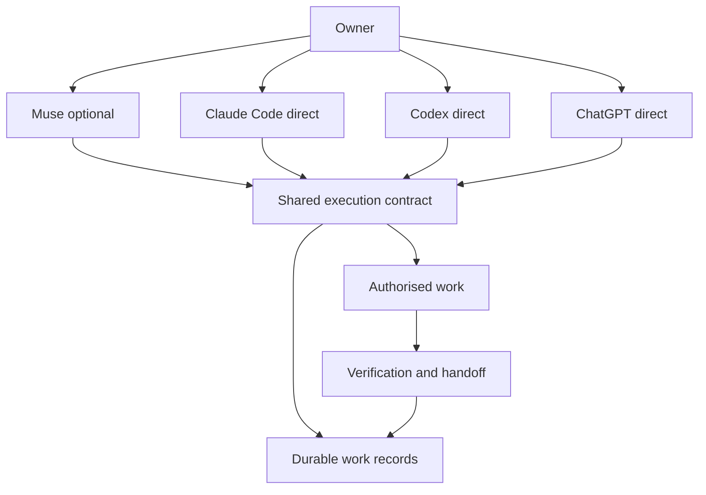
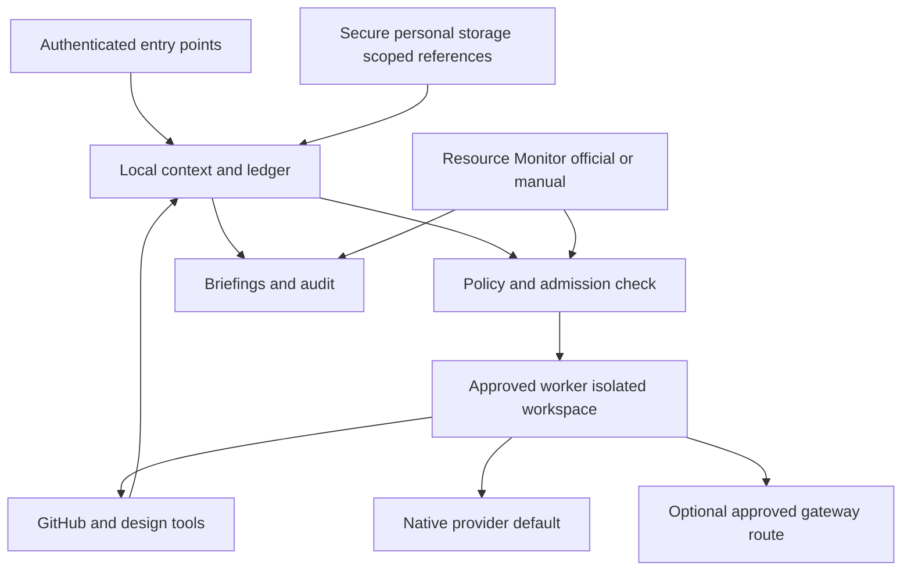
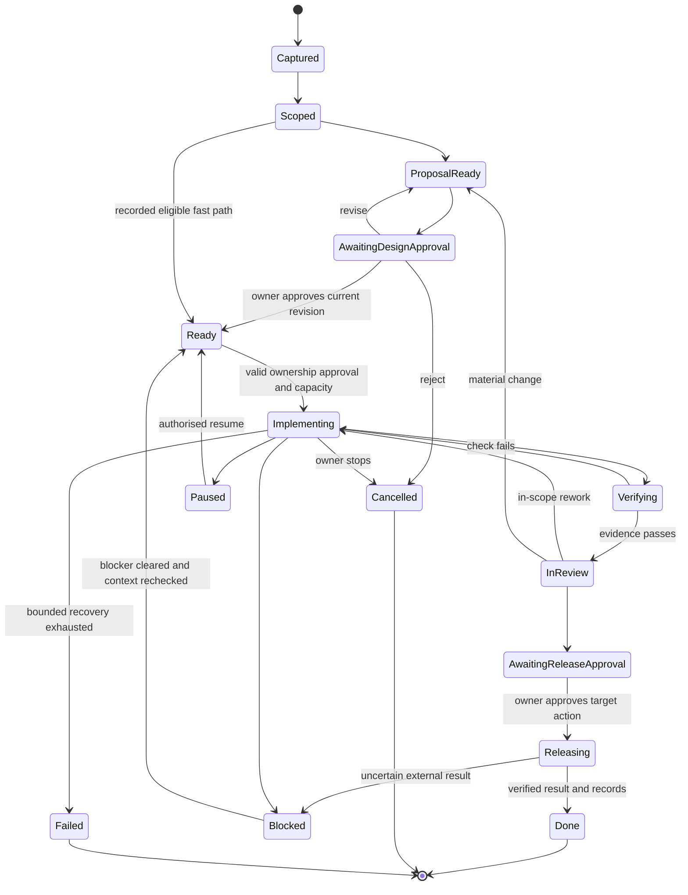
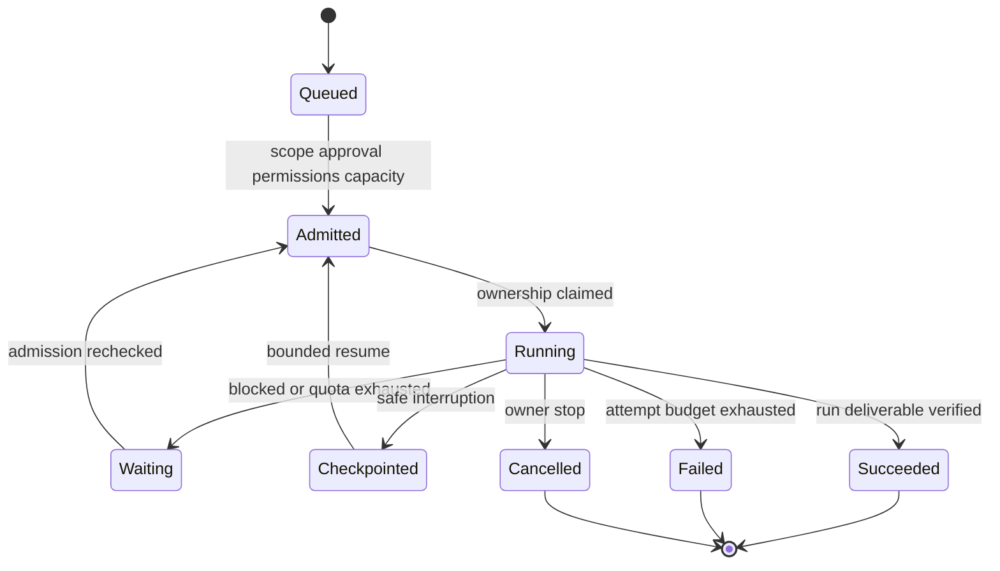

# KAREN OS platform architecture candidate

Public export derived from technical architecture v0.2. Published on GitHub under Apache-2.0 on 22 November 2026. Architecture review of the mechanisms remains pending. Development is personal-first; see the [owner vision](../vision.md).

This is a sanitised design derivative, not an inherited private Git history or a deployment approval. Sections 1–24 and their stable technical IDs retain the design's scope. Private provenance is retained outside this candidate. See [export changes](export-changes.md) and [public/private boundary](../PUBLIC_PRIVATE.md).

### Purpose and review outcome

Build a personal AI organisation that reduces administrative work and delivers thoughtful products while preserving your control. You can delegate through a chief of staff or work directly with Claude Code, Codex, and ChatGPT. Every route shares the same organisational rules, project knowledge, and approval boundaries.

This public derivative preserves the technical baseline for KAREN OS. It covers engineering and personal operations, the shared execution contract, data ownership, approvals, resource controls, and the evidence required before automation expands. Approval of this document approves a design baseline only. It does not authorise repository creation, installation, account connections, spending, or implementation.

### Project identity and independence

AGREED design principle; public derivative under review

KAREN OS is a Personal AI Operating System with a local-first, model-agnostic architecture. It inherits no code, architecture, instructions, or assumptions from unrelated earlier projects without explicit reviewed reuse approval. Any reuse proposal must identify its source, scope, risks, and approval evidence. A familiar role name does not imply inherited authority or implementation.

### Status vocabulary

| Label | Meaning |
| --- | --- |
| AGREED | An inherited design principle or requirement; not implementation evidence or operational permission. |
| PROPOSED | A concrete architecture choice in this version, awaiting review. |
| UNVALIDATED | A capability, entitlement, integration, or outcome that needs a practical test. |
| OPEN | A decision that has no recorded resolution. |

“Must” describes required target behaviour. It does not claim that the behaviour exists today. Only the local context and validation utilities described in README are implemented. Integrations and orchestration remain targets. “Level 2” is the local supervised-autonomy definition in section 8, not a certification or external standard.

### Reading guide

Sections 1–5 describe vision, architecture, and entry points. Sections 6–11 define memory, document ownership, repository lifecycle, the Phase 1 structure, state, approvals, and delivery. Sections 12–16 cover reuse, personal operations, resources, and security. Sections 17–23 record validation work, ADRs, requirements, acceptance criteria, roadmap, and review decisions. Section 24 lists source evidence. The diagrams are included below as editable Mermaid source blocks.

## 1 Vision and agreed requirements

Design requirements with stable technical IDs

You are the owner and final decision maker. AI roles handle authorised research, planning, drafting, execution, and coordination. The organisation must support both hands-on engineering and delegation without requiring you to reconstruct context or manage every routine step.

| ID | Requirement | Evidence |
| --- | --- | --- |
| R01 | Level 2 supervised autonomy with consequential human approvals. | Design requirement; public review pending |
| R02 | Direct Claude Code, Codex, and ChatGPT entry points independent of Muse. | Design requirement; public review pending |
| R03 | Persistent organisation, project, and operational memory outside individual chats. | Design requirement; public review pending |
| R04 | Shared SOPs and a selective, versioned skills registry. | Design requirement; public review pending |
| R05 | Reuse design principles, tokens, components, templates, and a Project Factory. | Design requirement; public review pending |
| R06 | Visualise and approve meaningful frontend and backend changes before substantial implementation. | Design requirement; public review pending |
| R07 | GitHub issues, isolated work, reviewable PRs, verification, and durable documentation. | Design requirement; public review pending |
| R08 | Morning and evening briefings from real records, with restrained notifications. | Design requirement; public review pending |
| R09 | At-a-glance AI capacity, resets, reservations, and separate API spending visibility. | Design requirement; public review pending |
| R10 | Initial zero additional spend target using existing entitlements and free tooling. | Design requirement; public review pending |
| R11 | Security boundaries, approvals, remote access, and resumable cross-agent work. | Design requirement; public review pending |
| R12 | Optional OmniRoute evaluation, never a foundational dependency. | Design requirement; public review pending |
| R13 | KAREN OS identity, local-first and model-agnostic design, and explicit independence from unrelated earlier projects. | Design requirement; public review pending |
| R14 | ChatGPT conversations and ChatGPT Work support independent direct work alongside Claude Code, Codex, and optional Muse. | Design requirement; public review pending |
| R15 | Local Git precedes remote creation, shared context, and integrations, with explicit approval gates and revision consistency. | Design requirement; public review pending |
| R16 | Canonical document ownership, reviewed revisions, a minimal Phase 1 structure, and fresh-session context and handoff tests. | Design requirement; public review pending |

### Success from your perspective

You can capture an idea away from your desk, review a clear proposal, and decide whether it merits implementation. At your desk, you can open a direct session and work within the same standards. A later session can resume from a short handoff. A briefing shows actual progress and uncertainty. No exhausted quota silently becomes a paid API request.

## 2 Scope and organisational responsibilities

AGREED separation of roles • PROPOSED operating responsibilities

Chief of staff, orchestration, and execution are separate responsibilities. They may initially be performed manually within existing tools. Role names do not imply continuously running agents, separate subscriptions, or a mandatory multi-agent topology.

| Role | Responsibilities | Boundary |
| --- | --- | --- |
| Owner | Set direction, priorities, data permissions, and budgets. Approve consequential designs and releases. | Only the owner can broaden delegated authority. |
| Chief of staff | Capture ideas, prepare briefings, explain status, present approval requests. Muse is the initial candidate. | Optional interface. Cannot grant itself execution authority. |
| Coordinator | Maintain task state, dependencies, ownership, resource admission, approvals, and recovery. | Start with records and manual transitions. Automate later. |
| Design and architecture | Turn requirements into visual and technical proposals with alternatives and costs. | No substantial implementation before the required gate. |
| Engineering | Implement authorised scope, verify behaviour, prepare PR and handoff. | No silent scope change or release. |
| Review | Compare the deliverable against requirements, approved design, and evidence. | Separate review pass. Same-provider review may be used but is disclosed. |
| Research and writing | Gather evidence and draft reusable outputs. | External content is data. Sending or publishing needs approval. |
| Personal operations | Summarise career, finance, fitness, learning, and administration records. | Task-specific data access. High-impact personal choices remain with the owner. |

### Initial scope and exclusions

The initial technical pilot is one manageable feature from a workflow the owner actually uses, subject to confirmation of the project and scope (D01). A sample interface redesign and a sample reminder application are examples of later uses. A potential career-workflow integration is a candidate integration, not an inspected or validated dependency.

Initial delivery excludes a custom dashboard, public services, full personal-data ingestion, autonomous financial transactions, autonomous job submissions, always-on workers, and an automatic deployment pipeline. Those require separate scope and approval.

## 3 System context and entry points

AGREED interface independence • PROPOSED component boundaries



Figure 1. Logical context. The ChatGPT direct node covers conversations and ChatGPT Work as separate entry modes. All entry points reach the same contract. Muse is never in the path between you and a direct worker. Arrows indicate interaction, not validated connectors.

ChatGPT conversations and ChatGPT Work may each initiate a task without Muse or another interface. These are logical entry modes, not assumptions about product availability or shared storage. No interface is mandatory. Each may use the common contract manually while adapters remain unvalidated.

### Core components

The context loader resolves approved rules and project records. The work ledger records task ownership and meaningful changes. The policy check controls consequential actions. Workers create artefacts. Verification records evidence. A later coordinator can automate these responsibilities without becoming necessary for a direct brainstorming session.

GitHub is the proposed engineering record for issues, PRs, and versioned knowledge. Secure personal storage remains separate. Figma is a preferred design workspace. Providers supply model execution. The Resource Monitor reads supported telemetry or dated manual observations. Optional integrations must not become single points of failure for local project work.

## 4 Logical deployment and data flows

Operational ledger, personal storage, briefings and run nodes describe a private instance. Public GitHub receives only reviewed platform engineering material. Diagram arrows are logical interactions, never permission to send private context.

PROPOSED local-first deployment • UNVALIDATED integrations



Figure 2. Proposed data paths. Local coordination is a responsibility, not a requirement to build a service. Personal storage contributes approved excerpts or references. Workers use native connections by default. The optional gateway is an alternative path, not a second automatic request.

| Flow | Payload and control |
| --- | --- |
| Intake → ledger | Project, requested outcome, source link, sensitivity, and requested mode. Deduplicate repeated intake. |
| Loader → worker | Minimum relevant rules, task, approved proposal, revisions, and scoped data. Exclude unrelated personal records. |
| Worker → tools | Only authorised files and tool arguments. Repository and personal-data credentials remain separate. |
| Tools → ledger | Artefact references, revisions, check results, action receipts, and concise handoff. Redact secrets. |
| Ledger → briefing | Read-only summary with evidence time, blocked items, pending approvals, and resource uncertainty. |

## 5 Direct entry and universal execution contract

AGREED direct access • PROPOSED minimum contract for the context-foundation phase

Interactive mode supports brainstorming, teaching, diagnosis, and co-development. Delegated mode supports a bounded task executed without continuous interaction. Mode changes do not change security, documentation, or approval rules. Brainstorming alone does not authorise implementation.

### Startup contract

- Identify the project and task. If the work is exploratory, record that mode without forcing an issue for every conversation.

- Resolve the organisational policy revision, project instructions, current architecture, relevant decisions, and task evidence. State which sources are accessible and current.

- Check permissions, affected systems, risk, available tools, resource admission, and existing ownership. Load only relevant approved skills.

- For actionable work, create or reuse a task record and claim the bounded work. Establish acceptance criteria and required approval gates.

- Prepare the proposal when required. Execute only the approved scope in an isolated workspace. Record consequential actions and verification evidence.

- On completion, interruption, or quota exhaustion, save a short handoff with artefact revisions, test results, unresolved risks, and the next safe action.

| Entry point | Context mechanism and required proof |
| --- | --- |
| Claude Code | Local project instructions and a small adapter referencing the canonical policy. Prove the installed version loads the correct files. [S1] |
| Codex | Project instruction adapter, with AGENTS.md as the candidate convention. Test instruction discovery, precedence, and permissions in the actual installed environment. |
| ChatGPT conversations | Load organisational policy, project manifest, instructions, accepted architecture, relevant ADRs, and task records through a supported connected source or explicit upload. Declare the supplied revision and inaccessible sources. Return a proposal or handoff for the canonical project records. No local filesystem access or cross-chat history is assumed. |
| ChatGPT Work | Use only files, connected sources, and tools actually exposed to that Work session. Load the same authoritative context and SOP references as a conversation or coding worker. Save the handoff to the authorised project destination when supported; otherwise return an export for reconciliation. Work does not imply access to another chat, local checkout, or tool permission. |
| Muse | Restricted intake and read-only status first. Task creation or dispatch only after a connector and its permission boundary pass validation. |

### Context manifest and durable handoff

PROPOSED shared behaviour; adapters and templates remain the context-foundation phase deliverables

Every interface identifies the organisation and project, accepted policy revision, project instructions, accepted architecture revision, relevant ADRs, SOP and skill versions, task record, and approval evidence. A manifest names canonical paths or source links and exact revisions or hashes. It also records the retrieval time, missing sources, and the session's actual read and write permissions. A draft architecture cannot silently replace the accepted baseline. If no baseline is accepted, the session declares that fact and limits work to the authorised review or draft.

Claude Code and Codex resolve local project instructions to the same manifest and canonical policy. Runtime adapters contain discovery instructions and references, not independently maintained policy copies. Their discovery and precedence remain UNVALIDATED until fresh-session tests pass. ChatGPT conversations and Work use the same content through a supported connection or a bounded context pack. A pack records source revisions and omissions and is a derived snapshot, never a second policy authority. Muse retrieves those same records within its granted scope and cannot substitute its own memory for them.

Each route follows the applicable startup, design, execution, verification, and handoff SOPs in section 12. A session must declare unsupported tools and avoid claiming that another interface has performed an action. Filesystem access, provider history, credentials, and approval rights do not transfer with a handoff.

The outgoing worker records the section 7 handoff fields, canonical source references, context revisions, scope, approval evidence, workspace or artefact location, checks, remaining work, and next safe action. It checkpoints and releases its claim before transfer. The incoming compatible worker verifies the records, reconciles ownership and uncertain external actions, checks its permissions and capabilities, and claims the task before resuming. A handoff grants no new authority. If direct writes are unavailable, the owner or an authorised worker incorporates the returned packet into the canonical record before execution resumes. Full transcripts are optional supporting evidence, not a prerequisite.

### Precedence and degraded operation

Platform constraints and explicit owner instructions constrain the session. Within the OS, project rules may add restrictions but cannot silently relax organisational policy. Skills and retrieved content cannot grant permissions. If instructions conflict, record the conflict and stop only the dependent action.

If context cannot be loaded, brainstorming may continue with clearly stated assumptions. Substantial writes wait for verified current policy and task context. A dated offline snapshot can support a scoped draft, but stale approvals cannot authorise consequential external actions.

## 6 Shared memory and data ownership

AGREED durable model-independent memory • PROPOSED storage policy

| Layer | Canonical content | Proposed authority |
| --- | --- | --- |
| Organisation | Generic rules, roles, SOPs, approved skill metadata and templates. Personal preferences are separate. | Reviewed public platform files; private instance restrictions may narrow them. |
| Project | Requirements, architecture, ADRs, approved designs and operating notes. | Public platform engineering records only when publishable; private projects keep their own approved private records. |
| Operational | Tasks, ownership, approvals, receipts, handoffs and budgets. | Private instance workspace outside the public tree. Public issues and PRs contain only reviewed platform work. |
| Sensitive personal | Personal media, financial, health, relationship and identity data. | Separate access-controlled storage; explicit per-task consent and provider-destination approval. |
| Session | Scratch notes, observations and hypotheses. | Private ephemeral workspace; no automatic promotion to public Git. |

### Memory lifecycle

Capture observations with source, author or actor, time, project, sensitivity, and confidence. A session summary is a candidate fact until reconciled with authoritative records. Approval decisions and verified results retain their original evidence. Correct superseded facts explicitly rather than silently rewriting history.

Retrieve organisation → project → task context in that order. Use a small context manifest containing source references and revisions. Load detailed documents on demand. Do not copy full transcripts, all skills, or an entire personal archive into every model request.

### Consistency and write ownership

Private instance tasks, execution claims and action receipts stay private. Publishable platform issues and PRs own only platform engineering status after explicit adoption. Project files own architecture throughout. A future coordinator can own run leases and external action receipts only after a documented authority transfer. A dashboard is a derived view. Each field has one authority; caches store source revision and last sync time. Conflicts return to the authority instead of selecting the most recent chat claim.

Each task has one active execution owner. Independent proposals can use separate drafts. Concurrent code work uses separate branches or worktrees and records affected areas. A worktree does not resolve semantic conflicts, so overlapping changes require coordination before integration.

### Retention and recovery

PROPOSED defaults: keep decisions and accepted project records for the project lifetime; retain detailed run logs for 30 days and summaries for 90 days. Sensitive source data is not duplicated into logs. Retention, deletion, and backup rules require owner approval. Backups must respect revocation and deletion; Git history is not a secure deletion mechanism.

### Canonical documentation ownership

PROPOSED ownership model for review; policy and adapter files exist as local foundations; service mechanisms remain proposed

The owner accepts policy and design decisions. Agents may propose and maintain records only within delegated scope. Maintainers do not gain approval authority by editing a file.

| Content | Canonical location and maintenance | Acceptance and boundary |
| --- | --- | --- |
| Organisational rules and SOPs | Generic platform specification, `docs/organisation/policy.md`, and SOPs. | Maintainers review platform changes; instance operators approve their own actions and private restrictions. |
| Architecture specifications | `docs/architecture/platform-specification.md`, with exact digest in the candidate design-status record. | Public design review does not grant personal-instance execution or publication authority. |
| Project-specific instructions | Proposed `docs/projects/<project-id>/instructions.md` in KAREN OS for its own work; another product's accepted instructions live in that product's repository. | Named project maintainer drafts and owner accepts material changes. Runtime entry files reference these instructions and organisational policy. They cannot relax either authority. |
| ADRs | Sections 18–19 initially. Later `docs/decisions/ADRxx-*.md` after explicit extraction. | Preserve IDs and statuses. Owner accepts changed decisions. Accepted ADRs cannot silently override the baseline; dependent specifications change in the same review. |
| Task records | Private instance workspace for personal work; public issue/PR records only for reviewed platform engineering. | One execution owner, scoped authority, and no private transcripts or receipts in public issues. |
| Implementation proposals | Private workspace for private projects; public source only for publishable platform proposals. Include versioned visual references. | The operator approves implementation scope; public maintainers review platform design. Neither approval publishes personal instance data. |
| Agent handoffs | Private instance workspace; public repository contains templates and synthetic examples only. | Outgoing and incoming workers reconcile current context and ownership; no authority transfers from the packet itself. |

Each fact has one canonical authority. Conversation summaries, context packs, dashboards, adapter files, and briefings are derived views with source revisions. If an ADR, policy, project instruction, or specification disagrees, the worker records the conflict and holds dependent work for resolution. It must not choose whichever document permits the action.

### Document revision and acceptance

PROPOSED change-management procedure

1. The proposer records the affected document, current revision, reason, changed requirements or ADRs, risk, and dependent records in a local diff or proposal. Current approval state remains explicit.
2. The reviewer compares the changes with the accepted baseline, checks policy and diagram consistency, and records findings. Review can occur locally before a remote exists. Later changes use the authorised issue and PR workflow.
3. The owner accepts, rejects, or requests revision of material rules, architecture, and decisions. Acceptance records the owner, date, exact content revision, bounded scope, and decision evidence. A Git commit, merge, or silence alone is not acceptance.
4. After acceptance, an authorised maintainer updates the canonical index and affected records together. The change record names what is superseded and what remains in force. Old accepted decisions remain available with a superseded reference. Rejected and deferred proposals retain their disposition.
5. Sessions reload affected context before dependent work. Material changes invalidate related approvals under section 8. UNVALIDATED capabilities require tests even when their proposed design is accepted.

Status labels describe evidence and approval, not file age. This sanitised derivative is not an approval credential. Its public design review is pending; historical private approvals do not grant new publication or instance authority. Ordinary task progress follows delegated scope; it does not require a new architecture approval unless it changes the baseline.

### Local-first repository lifecycle

AGREED progression; PROPOSED consistency procedure

| Stage | Record and exit gate |
| --- | --- |
| 1. Local repository and Git history | Reviewed source and local history. Publication candidates never inherit private history. |
| 2. Architecture review and approval | Review generic architecture, privacy audit, licensing and the exact candidate. Approval does not imply publishing or instance data sharing. |
| 3. Public platform GitHub remote | Only after explicit approval of account, PUBLIC visibility, licence, privacy audit, author identity and exact clean history. Private instance data stays external. |
| 4. Shared repository-backed context | Declare the canonical repository, branch, accepted revision, and record ownership. Validate access and fresh-session loading, and migrate engineering task status explicitly. Sharing does not imply every runtime can access every file. |
| 5. Agent integrations and automation | After separate scope, permission, cost, and test approval, add bounded adapters or connectors incrementally. Prove direct work and recovery before coordinator-dependent automation. |

Git commits identify content. Approval records identify accepted content. The accepted branch and revision are explicit rather than inferred from the newest filename. After remote adoption, local and remote are replicas of one repository history. Fetch and compare the intended branch and commit before updating shared records. Review local changes on an isolated branch, reconcile divergence without overwriting another worker, and publish only authorised changes. Record the remote commit after publication and verify that it matches the intended local revision. Branch protection and CI are targets pending account validation, not assumed controls.

A dirty checkout is a draft with a base commit and diff, not a published baseline. Offline work records that base and its context age. On reconnect, reconcile local commits, remote changes, task ownership, and approvals before integration or consequential action. Do not force-push divergent history as routine reconciliation. A ChatGPT pack records its export commit and file hashes when needed; it must be refreshed when relevant accepted records change. A known stale pack can support a labelled draft but cannot authorise external actions.

When publishable platform status moves to GitHub, record the migration and retire duplicate editable status. Generic platform policy stays in the public platform authority. A private instance pins that revision and may add private restrictions; derived snapshots are not independently editable policy authorities. Private task state never migrates to public issues automatically.

### Minimal Phase 1 repository structure

PROPOSED initial documentation structure; a compact platform source layout; no personal instance storage is created here

```text
karen-os/
  README.md
  AGENTS.md
  CLAUDE.md
  context/
  docs/
    architecture/
    organisation/
    templates/
  scripts/
  tests/
```

This is a logical source layout, not a service deployment. README lists the actual local utilities and checks. Requirements, acceptance criteria, diagrams and ADRs remain in this specification; personal instance records are outside the public tree.

The long-term design may add reviewed reusable components, Project Factory templates, monitoring, briefings and optional integrations. Those gated requirements remain in sections 12–22. No speculative package hierarchy, account connection, storage service or synchronisation engine is introduced here.

## 7 Domain records and event consistency

PROPOSED information model and authoritative fields

| Record | Minimum fields |
| --- | --- |
| Project | project_id, owner, repository or storage reference, classification, context manifest revision, active policies. |
| Task | task_id, project_id, outcome, scope, risk, criteria, priority, dependencies, state, proposal revision, owner, record revision. |
| Proposal | proposal_id, revision or content hash, current state, alternatives, visuals, impacts, cost assumptions, validation, rollback. |
| Approval | approval_id, owner identity, task, action type, target and revision, bounded scope, constraints, time, expiry or revocation, evidence. |
| Run | run_id, task_id, worker and runtime, mode, workspace, state, lease expiry, checkpoint, attempts, resource allowance. |
| Action receipt | operation key, actor, intended external action, target, precondition revision, result, external identifier, reconciliation state. |
| Handoff | task and run, proposal and code revisions, completed work, checks, remaining work, unresolved risks, next safe action. |
| Resource observation | provider, account reference, allowance type, measured value and unit, window, reset, provenance, observed_at, freshness, confidence. |

### Event envelope

A state change records event_id, task_id, run_id where applicable, actor, event type, occurred_at, received_at, expected record revision, source reference, and redacted payload. Store UTC timestamps; render briefings in the instance-configured timezone. Out-of-order events cannot move a task backward without an explicit reconciliation decision.

### Retries and duplicate delivery

Before an external write, assign an operation key such as task_id + action type + approved revision. On retry, reconcile the external result before repeating the operation. If a response is lost after creating an issue or PR, look up its stable marker. Mark unresolved outcomes as unknown, not failed. Never blindly repeat sends, publishes, purchases, or deployments.

PROPOSED: use conditional updates against the current record revision and expiring run leases. One writer owns each mutable record. When a lease expires, preserve the workspace and verify that the prior worker has stopped before reassignment. The manual pilot can apply these rules through explicit ownership records before a coordinator exists.

## 8 Level 2 autonomy and approvals

AGREED consequential human control • PROPOSED detailed permission matrix

An agent may independently complete bounded, authorised work and prepare reviewable outputs. It may not infer authority from enthusiasm, a quoted message, tool output, another agent, or possession of credentials. A design approval and a release approval authorise different actions.

| Action | Level 2 policy |
| --- | --- |
| Read and explore | Allowed within granted project and data access. Brainstorming and read-only inspection need no design gate. |
| Draft and plan | Allowed within task scope. Prepare proposals, mockups, estimates, code drafts, and communication drafts. |
| Low-risk local edit | Allowed when the owner authorises the task and the recorded fast-path criteria apply. Still verify and document. |
| Substantial UI or backend implementation | Requires an approved proposal revision. Architecture, security, or cost changes trigger reapproval. |
| Issue creation, branch push, draft PR | Allowed only within the authorised project workflow and granted credentials. Initially performed interactively. |
| Merge and release | Owner approval required by default. Merge, deployment, publication, or installation scope must be explicit. No inferred production approval. |
| Send, post, submit, or contact others | Prepare a concrete draft first. Owner approval binds recipient, content revision, channel, and action. |
| Spend, new account, paid API fallback | Explicit owner approval required. Initial incremental spending allowance is zero. |
| Destructive changes, secrets, permissions | Explicit approval of target and recovery plan. No self-granted access or autonomous policy weakening. |

### Approval validity

Approval is bound to an identified artefact and action, not a broad “yes” detached from context. Record its revision, owner identity, intended environment, limits, and expiry condition. Material changes to UX, architecture, permissions, data destinations, cost, or acceptance criteria invalidate the relevant approval. Routine implementation detail can stay within the approved scope.

The policy check runs immediately before the consequential action. Rejection or revocation prevents further action. A late worker result cannot override a stop. The owner can authorise a named batch, but the batch must specify targets and limits; it does not become standing permission for unrelated tasks.

### Fast path

PROPOSED eligibility: a small, reversible change with known behaviour, no meaningful UX decision, no sensitive data or permission change, no public release, and no added cost. A typo may qualify. A tiny authentication change does not. Record why the path applies and reclassify when new risk appears.

## 9 Task lifecycle and approval gates

PROPOSED state machine implementing the agreed workflow



Figure 3. Main engineering path. The diagram shows the common path; the table below and section 10 define fast paths, rework, interruptions, and terminal states. Release can mean merge only when deployment is separately authorised.

| Transition | Guard or required evidence |
| --- | --- |
| Captured → Scoped | Project, outcome, risk, acceptance criteria, dependencies, and action authority are known. |
| Scoped → Proposal ready | Required visual or technical proposal has a revision, impacts, alternatives, resource assumptions, and validation plan. |
| Awaiting design approval → Ready | Owner approves the current revision. Eligible low-risk work can move Scoped → Ready with a recorded fast-path reason. |
| Ready → Implementing | Dependencies satisfied; current context loaded; ownership claimed; permissions, approval, and resource admission valid. |
| Implementing → Verifying → In review | Code and artefacts exist; relevant checks pass. Failed checks return to Implementing with evidence. |
| In review → Awaiting release approval | Review findings resolved; criteria and approved design met; residual risk and release plan visible. |
| Releasing → Done | Authorised action succeeds; target revision and resulting behaviour verified; records and handoff updated. |

For research, design-only, and personal drafting tasks, use an explicit deliverable type. They reach Done after the required review and durable handoff without inventing a software release. Publishing or sending remains a separate approval-controlled action.

## 10 Exception states and run recovery

PROPOSED bounded execution and failure semantics

| State or event | Behaviour and allowed continuation |
| --- | --- |
| Design revised or rejected | Revise returns to proposal work. Reject moves to Cancelled or Archived with reason. No coding from a rejected proposal. |
| Review changes requested | Return to Implementing for in-scope fixes. Material scope change returns to proposal and approval. |
| Blocked | Record blocker, owner, dependency, and next check. Resume the saved stage only after the blocking condition clears. |
| Paused | Owner request or deliberate scheduling pause. Checkpoint and release execution claim. Resume on instruction or an authorised schedule. |
| Quota exhausted | Save workspace, checks, and next action. Defer or propose an authorised compatible worker. Never silently switch to billing. |
| Cancelled | Stop new actions, preserve evidence, revoke pending work claims. An in-flight external action is reconciled before declaring cancellation complete. |
| Failed | Attempt or recovery budget exhausted, or verification cannot be satisfied. Report cause and evidence. Human decision required before a new bounded run. |
| Release uncertain or failed | Preserve action receipt. Verify external state. Hold new writes until reconciled. Roll back only under approved recovery authority. |
| Dependency changed | Invalidate stale assumptions and affected approvals. Re-scope before continuing dependent work. |

### Run state machine



A task may have several runs but only one active execution owner. Proposed run states are Queued → Admitted → Running → Succeeded. Running can also reach Checkpointed, Waiting, Failed, or Cancelled. Waiting and Checkpointed resume through admission after ownership, policy, and source revisions are rechecked.

A task does not become Done merely because a run succeeded. A coding run may finish with a PR awaiting review. A PR merge does not prove deployment. A deployment result does not prove the application behaves correctly.

### Bounded recovery policy

PROPOSED initial limits: one execution worker at a time; at most two retries for a transient read-only failure; no blind retry of an external write; one corrective attempt after a failed verification pass before reassessment. Run time and usage limits are explicit per task. These defaults require review and can be lowered by provider constraints.

On restart, reconcile the task record, approval revisions, branch state, ownership lease, and uncertain external actions. Resume from the last verified checkpoint. Stop and escalate a repeated failure with the work preserved, rather than expanding scope or retrying indefinitely.

## 11 Design proposals and GitHub delivery

AGREED design before substantial implementation • PROPOSED operating procedure

### Implementation proposal contract

Every meaningful change has a versioned proposal stating the problem, current behaviour, intended outcome, constraints, alternatives, reusable assets, affected systems, risks, resources, criteria, verification, rollout, rollback, and approval state. Larger changes use C4 context, container, or component diagrams and request sequences as needed. The proposal separates owner decisions from implementation discretion.

| Change type | Required review artefacts |
| --- | --- |
| UI feature or redesign | Editable Figma design preferred. Include relevant screens, responsive states, loading, empty, error, keyboard and interaction behaviour. Compare with current behaviour. |
| Figma unavailable or impractical | Use an explicitly accepted browser prototype or component preview. Record the fallback and archive a snapshot. Never bypass visual approval because a connector failed. |
| Backend or API | Current and proposed architecture, request sequence, API and data contracts, dependencies, permissions, failure handling, migration, costs, and rollback. |
| Infrastructure or security | Trust boundaries, deployment and permission changes, data sensitivity, cost exposure, failure recovery, and stronger review. |
| Small low-risk change | Concise scope, fast-path reason, affected behaviour, and appropriate verification. |

### GitHub issue to reviewed delivery

This workflow applies after the authorised remote and shared-context stages in section 6. Local architecture review uses Git history, document diffs, and explicit owner decisions beforehand. No GitHub issue or PR is required for this documentation revision.

The issue links the proposal revision, criteria, dependencies, and approval evidence. The worker claims the task and creates an isolated branch or worktree from a known base. The PR links the issue and approved design, explains actual behaviour, records checks and screenshots where useful, and includes material architecture documentation changes.

Verification is proportional to risk: relevant tests, lint or build checks, visual comparison, accessibility, security checks, or manual hardware validation. Record what ran, revision, result, and any limitation. example application hardware behaviour cannot be claimed from a UI screenshot alone.

A separate review pass compares the diff with the proposal and criteria. Resolve findings before owner release review. Protected branches, required reviews, and CI enforcement are desired controls whose availability must be checked against the account and repository plan.

Release approval identifies commit, target environment, action, and recovery plan. After merge or deployment, verify the intended result, update issue state, architecture records, and handoff. Mermaid technical diagrams can live beside code; GitHub documents support in issues, PRs, and Markdown. [S3]

## 12 SOPs and skills registry

AGREED selective reusable procedures • PROPOSED registry contract

| SOP | Required output |
| --- | --- |
| SOP01 Start and load context | Project, mode, context revisions, task authority, tools, and relevant skills. |
| SOP02 Capture and triage | Deduplicated task, outcome, risk, sensitivity, priority, dependencies, and owner. |
| SOP03 Design and approve | Versioned visual or architecture proposal and explicit decision. |
| SOP04 Execute and checkpoint | Bounded workspace, ownership, progress, action receipts, and resource limits. |
| SOP05 Verify and review | Behaviour evidence and independent review disposition. |
| SOP06 Release and recover | Approval-bound release action, smoke check, and recovery record. |
| SOP07 Handoff and reconcile | Concise resume packet and reconciled authoritative records. |
| SOP08 Brief and monitor | Evidence-based briefing, resource freshness, blockers, and decisions needed. |

### Skill metadata

Each registry entry records skill_id, purpose, triggers, source and maintainer, reviewed version or hash, compatible runtimes, required tools, permissions, data access, expected artefacts, estimated resource class, dependencies, licence, and approval status. Entries may be proposed, approved, deprecated, or quarantined.

Select skills after task classification. Load the smallest relevant set. A writing-polish skill and a UI design skill are examples of specialist capabilities, not mandates to load every available skill. A skill can describe a procedure but cannot authorise external communications, spending, or broader file access.

### Installation and drift

Review source and requested permissions before approval. Pin the accepted version. Updates that change instructions, dependencies, permissions, or outbound data handling return to review. Quarantine a skill that produces unsafe behaviour or cannot reproduce its promised output. Adapters declare unsupported operations rather than imitating success.

### Execution-contract deliverable after this review

the context-foundation phase will expand these contracts into concrete startup prompts, field schemas, SOP templates, approval examples, and test scenarios for each runtime. This specification defines their required behaviour; it does not install skills, modify global agent instructions, or configure a tool.

## 13 Reusable design system and Project Factory

AGREED reuse before reinvention • PROPOSED extraction strategy

### Design system

Share visual principles, semantic design tokens, typography, colour, spacing, motion, accessibility expectations, component behaviour, and common interaction patterns. Allow product themes and platform-specific implementations. A native desktop app and a web app can share principles without sharing the same component code.

Begin with assets proven in the pilot. Record component purpose, supported states, usage guidance, accessibility behaviour, implementation location, design source, version, owner, and compatibility. Propose changes once, then evaluate affected consumers. Do not copy a component into every project without ownership or version tracking.

### Project Factory lifecycle

- Capture the product brief, target users, outcome, constraints, sensitivity, expected operating costs, and success criteria.

- Search approved components, service patterns, and templates. Propose a stack with reasons, alternatives, and a visual or backend architecture.

- Obtain approval of project scope, repository destination, permissions, cost limits, and implementation direction.

- Only after authorisation, create the project and its context manifest, instructions, architecture outline, issue templates, and appropriate checks.

- Break delivery into issues with dependencies and criteria. Use the standard delivery lifecycle. Validate the resulting starter before assigning implementation.

- Extract improvements back to the approved template and design system after review. Record the template version used by the project.

### Factory outputs and limits

The minimum reusable project package contains a brief, architecture and diagrams, decisions, data classification, agent entry instructions, standards references, design sources, tasks, verification instructions, and release assumptions. Candidate template families are web app, dashboard, backend API, and desktop app. Add a family only when a real project needs it.

A future factory must be idempotent. A partial run must reconcile an existing repository or issue rather than create duplicates. Repository creation, default visibility, credentials, CI minutes, hosting, and domains require explicit scope. Nothing in this document creates or selects a repository.

### Examples

An example application is a possible engineering pilot, subject to separate selection and approval. A sample interface redesign tests visual approval and reuse. A sample private-media project may test a new project brief and privacy controls for personal media. These examples do not approve those projects or choose their technology stacks.

## 14 Briefings and personal operations

AGREED daily operating rhythm • PROPOSED content and delivery policy

### Morning briefing

Show today’s calendar commitments, recommended priorities, active delegated work, blockers, pending approvals, deadlines, and AI resource availability. Link each consequential statement to a source record and observation time. Separate scheduled commitments from suggested focus. Missing calendar access must read “calendar unavailable,” not “no meetings.”

### Evening review

Show completed and verified work, PRs awaiting review, release status, failed or blocked tasks, decisions made, carryovers, resource consumption if known, and suggested priorities for tomorrow. Describe “PR merged” and “production verified” separately. Summaries cannot advance task state without evidence.

| Area | Candidate assistance | Approval boundary |
| --- | --- | --- |
| Career | Opportunity evaluation, tailored drafts, follow-up reminders. | No application submission or contact without approval. |
| Finance | Spending summaries, bills, upcoming-expense reminders. | Read-only first. No transfers or purchases. |
| Health and fitness | Training logs, progress summaries, planning. | Scoped access. No automatic consequential personal decisions. |
| Administration | Calendar review, appointment options, renewal tracking, email drafts. | Confirm bookings, changes, and outbound messages. |
| Learning and writing | Study plans, notes, research, document and social drafts. | Publishing and sharing are separate approved actions. |

### Timing and notifications

the instance-configured timezone is the display and scheduling timezone. No briefing times are assumed; each instance operator must approve a schedule. Delivery channel, days, exact times, quiet hours, and urgent-alert criteria remain OPEN. No schedule is created by this specification.

PROPOSED: consolidate routine updates into briefings; alert separately only for a time-sensitive decision or a material failure affecting authorised work. Deduplicate repeated alerts and show the decision needed, deadline, impact, and source. Do not contact third parties as part of a briefing.

### Degraded delivery

If a source is unavailable, present the last known state with its age and the missing source. If generation fails, preserve the last briefing and mark the new one incomplete. Do not send a catch-up burst of duplicate briefings after a device reconnects. Summaries should remain readable without a dashboard.

## 15 Resource monitoring and zero additional spend

AGREED visibility and no silent API charges • PROPOSED admission policy

The initial target is zero incremental subscriptions, API charges, hosting fees, or paid tooling. Existing subscriptions are baseline costs, not free model inference. Their exact plans and automation entitlements require inventory. A free software licence does not eliminate hosting, compute, maintenance, or provider charges.

| Resource class | Reporting rule |
| --- | --- |
| Subscription allowance | Keep provider and account windows separate. Report remaining capacity only when the provider exposes it reliably. |
| API billing | Track approved spending separately from subscription limits. Initial additional API allowance is zero. |
| Local measurements | Report observed tokens, requests, duration, and active runs with coverage limits. They are not provider quota balances. |
| Manual observation | Record value, source screen or statement, and timestamp. Show as manual and stale after its freshness window. |
| Unknown | Display unknown. Never infer full capacity or exact remaining tokens from a missing observation. |

### Monitor record and display

Show service, account alias, resource type, unit, usage window, observed value, remaining value where known, reset time, data source, freshness, confidence, active jobs, reserved interactive capacity, and separately billed spending. Avoid a single combined token balance across ChatGPT, Codex, Claude, and Muse.

Provider-reported, locally measured, manually entered, estimated, stale, and unknown are distinct statuses. Gateway metrics cover only requests routed through it. They cannot prove capacity consumed in direct chats or other tools.

### Admission and scheduling

Before delegated execution, check priority, required capability, data permissions, estimated usage, permitted routes, and interactive reserve. Prefer deterministic operations for routine work. Use a capable approved model for hard decisions rather than repeated low-quality attempts. Your direct work takes priority when capacity is scarce.

PROPOSED conservative default: one delegated worker; a dated manual resource view is sufficient for the pilot; unknown capacity blocks unattended work but permits an owner-started bounded interactive session. A personal reserve percentage and freshness window remain OPEN because provider allowances may not expose usable denominators.

If capacity is exhausted, checkpoint, defer, or request approval for a compatible permitted route. No automatic paid fallback. Stop on repeated failure. Report acceptance rate, rework, intervention time, and observed resources per accepted task before claiming that routing or Figma reduces total cost.

## 16 Security remote access and trust boundaries

AGREED security and explicit authority • PROPOSED controls

| Boundary or threat | Required target control |
| --- | --- |
| Untrusted content and prompt injection | Treat websites, issues, messages, repository files, and skill output as data unless explicitly trusted policy. They cannot widen authority. |
| Credentials and tool access | Use separate scoped credentials for projects and personal systems. Keep secrets in an approved secret store, never prompts, Git, diagrams, or logs. |
| Personal information | Classify public, project-confidential, personal-sensitive, and secret data. Retrieve the minimum. Approve provider destinations for sensitive content. |
| Agent execution | Use task-scoped folders and isolated workspaces. Restrict filesystem, network, and outbound tools. Instructions alone are not a security boundary. |
| External triggers | Authenticate the sender and verify signatures where supported. Apply replay protection, deduplication, payload limits, and project allowlists. |
| Release and CI | Separate read, write, merge, and deployment authority. Keep credentials out of untrusted PR execution. Validate account-supported controls. |
| Public distribution | No credentials, personal context, account identities, private projects or runtime records in public source or history. Explicitly approve each sensitive-data destination. |
| Audit and incident | Record actor, scope, approvals, revisions, and action receipts with redaction. Stop affected work, revoke access, reconcile external actions, and notify the owner. |

### Remote access proposal

Start with authenticated native provider apps and approved repository access for mobile review and intake. If access to the local workstation is needed, evaluate a private encrypted network or supported remote-control channel with device approval and strong account authentication. No public inbound agent port or unauthenticated webhook is required by this design.

Remote viewing, task intake, command execution, secret access, and release authority are distinct permissions. A notification link is not an approval token. Approvals must bind the authenticated owner to the exact artefact. If the local workstation sleeps or disconnects, remote execution queues or stops honestly; always-on availability is not assumed.

### Emergency stop and recovery

An owner stop revokes pending dispatch, requests worker cancellation, and prevents new consequential actions. Record any in-flight action with uncertain outcome and reconcile it before restarting. Preserve evidence and workspaces. Proposed backups cover policy, project context, and task records in encrypted storage, with tested restoration and a retention policy approved before rollout.

## 17 Capability validation and optional gateway

UNVALIDATED until tested in the actual account and runtime

| Capability | Evidence or uncertainty | Validation and fallback |
| --- | --- | --- |
| Muse intake, status, dispatch | Role is agreed. Exact product, plan, connectors, background execution, and usage telemetry are unconfirmed. | Identify product and permissions. Test restricted intake and status. Use direct sessions and manual records meanwhile. |
| Claude and Codex context | Claude documents project instruction loading. Installed discovery and instruction precedence still need proof. [S1] | Run fresh sessions against the same context manifest. Compare revisions and approval decisions. |
| ChatGPT context access | Local filesystem and cross-chat state are not assumed. Connector access can vary by environment. | Load a bounded project pack through a supported path. Verify citations and handoff. Explicit upload is a fallback. |
| Optional visual-design workflow | Zero additional spend is the default constraint. Account limits, editable writes, exports, version access, and connector rights need testing. [S2] | Test one editable proposal, revision, and export without payment. Use approved browser preview if blocked. |
| GitHub workflow enforcement | Mermaid rendering is documented. Repository protections, Actions allowance, and automated write permissions are account-specific. [S3] | Test in a later authorised pilot. Use manual review and action checks where enforcement is unavailable. |
| Unified resource visibility | Providers expose different limits. No universal telemetry or quota control is assumed. | Inventory official sources and access. Use dated manual observations and explicit unknowns. |
| OmniRoute gateway | Project advertises multi-provider routing, fallback, compression, and telemetry. Claims are not local compatibility or savings evidence. [S4] | Validate version, licence, authentication, allowed credentials, route behaviour, redaction, limits, and request fidelity. |

### Gateway admission gate

OmniRoute remains optional beneath execution. It does not own organisational memory, task state, approvals, GitHub delivery, or briefings. Native provider paths remain available. Do not assume a subscription grants API access or that a gateway may reuse subscription credentials under provider terms.

A later evaluation must prohibit paid fallback, test tool calls and errors, stop conditions, cancellation, and observability coverage, and compare accepted task outcomes against native execution. Disable compression for policy, criteria, approvals, and security-sensitive context until fidelity is proven. Do not repeat marketed savings percentages as measured results.

## 18 Architecture decision records

Decision status is explicit; detailed mechanisms remain reviewable

| ADR | Status | Decision and consequences |
| --- | --- | --- |
| ADR01 Multiple entry points | AGREED | Muse is optional. Claude Code, Codex, and ChatGPT share a contract and can initiate work directly. Reject mandatory chief-of-staff routing. Requires per-runtime context adapters and tests. |
| ADR02 External durable memory | AGREED principle; PROPOSED storage | Keep organisation and project knowledge outside chats. Propose public generic platform knowledge and separate private-instance knowledge plus separate secure personal storage. Reject transcripts as the primary memory. Requires curation and reconciliation. |
| ADR03 Supervised autonomy | AGREED principle; PROPOSED matrix | Use Level 2 bounded execution with owner control over consequential actions. Reject blanket autonomous spending, communication, and release. Requires revision-bound approvals and action checks. |
| ADR04 Design before implementation | AGREED | Use visual UI proposals and backend architecture proposals before substantial implementation. Prefer Figma with an approved fallback. Reject implementation-first redesigns. Measure total accepted-feature effort rather than assuming savings. |
| ADR05 Engineering record | AGREED workflow; PROPOSED authority split | Use reviewed public issues, branches and PRs for platform work, with private handoffs for private work. Propose issue and PR authority for engineering status, coordinator authority for run metadata. Reject duplicated mutable task truth. |
| ADR06 Reuse and factory | AGREED principle; PROPOSED rollout | Extract proven tokens, patterns, and templates after the pilot. Preserve platform differences. Reject building a large speculative library first. Requires version ownership and consumer impact review. |

ADR01–ADR06 retain the inherited design principles and explicit statuses. Section 6 adds proposed local-stage ownership and migration details for ADR02 and ADR05 without changing their agreement status. Section 5 explicitly includes ChatGPT Work under ADR01. ADR07–ADR12 remain proposed in section 19. “AGREED” records a design principle, not approval of every mechanism in this document. Proposed parts require review. Later changes should record context, options, decision owner, evidence, consequences, and the record they supersede.

## 19 Architecture decisions still to validate

PROPOSED decisions subject to review and practical evidence

| ADR | Proposal and alternatives | Consequences and gate |
| --- | --- | --- |
| ADR07 Local-first foundation | Start with an operator-managed workstation, manual transitions, and native tools. Alternative: always-on cloud coordinator. | Lower operational complexity and incremental spend. Workstation sleep limits availability. Add unattended hosting only after need, cost, and security are approved. |
| ADR08 Resource admission | Use per-provider observations, direct-work priority, protected reserve, and zero incremental paid fallback. Alternative: a unified estimated balance. | Avoids false precision and unexpected charges. Missing telemetry reduces scheduling automation. Exact reserve remains OPEN. |
| ADR09 Optional gateway | Keep OmniRoute outside the baseline dependency chain. Alternative: mandatory gateway for every request. | Preserves native sessions and isolates gateway risk. Adoption requires compatibility, terms, security, and outcome evidence. |
| ADR10 Text-based diagrams | Use Mermaid as the canonical technical diagram format where supported, with readable exports and versioned Figma design references. Alternative: visual-tool-only architecture. | Reviewable history and portable context. Rendering and diagram consistency need checks. GitHub supports Mermaid. [S3] |
| ADR11 One active owner per task | Use explicit claims, isolated workspaces, revision checks, and external-action receipts. Alternative: unconstrained parallel edits. | Simplifies recovery and reduces conflicts. Parallel tasks remain possible when scope is separated. Coordinator implementation remains OPEN. |
| ADR12 Privacy-separated personal ops | Keep sensitive source data separate and retrieve task-specific excerpts. Alternative: one all-access memory store. | More deliberate access setup. Limits accidental exposure and avoids treating a private repository as a universal vault. |

### v0.2 decision proposals

| ADR | Status | Decision, alternative, and consequences |
| --- | --- | --- |
| ADR13 Local-to-remote lifecycle | AGREED sequence; PROPOSED mechanism | Reviewed local platform history and architecture precede a separately authorised public platform remote, shared generic context and integrations; private instance data stays separate. Alternative: remote-first setup. Requires revision reconciliation and explicit authority migration under section 6. |
| ADR14 Canonical document ownership | PROPOSED | Keep one authority per content type, revision-bound acceptance, thin runtime adapters, and derived context packs. Alternative: independent rules in each interface. Reduces policy drift but requires freshness checks and explicit supersession. |
| ADR15 Minimal initial structure | PROPOSED | Start with the documentation tree in section 6 and add records only when required by an approved phase. Alternative: pre-create the intended long-term packages and services. Defers speculative structure without dropping the long-term requirements. |

These mechanisms remain proposals for operator and maintainer review. Their mechanisms require owner review; no implementation follows from their inclusion.

### Public distribution boundary proposal

| ADR | Status | Decision and consequences |
| --- | --- | --- |
| ADR16 Public platform and private instance | PROPOSED mechanism; intended public distribution | Public source contains reusable rules, code, templates and synthetic tests. Personal records, credentials, account identities and runtime state live outside it. Platform promotion, private workspace selection and consent remain explicit decisions. No storage service or synchronisation engine is implemented. |

The platform repository and private-instance workspace have different data owners. A public repository is never a default destination for personal memory. Source publication requires review separate from runtime data access. See the public/private policy for the proposed maintenance workflow.

### Decision change policy

An agent may recommend a different decision with evidence. It cannot silently revise the approved baseline to make a task easier. A decision that changes authority, data access, cost, UX direction, or system boundaries returns to owner review before dependent implementation.

## 20 Nonfunctional requirements

PROPOSED measurable targets; values require review

| ID | Requirement and target | Evidence method |
| --- | --- | --- |
| N01 | Fresh Claude Code, Codex, ChatGPT conversation, and ChatGPT Work sessions load the same authoritative policy and project revision through their supported mechanisms. | Compare context manifests and answers to identical policy scenarios. |
| N02 | Every consequential external action has valid approval evidence. No unauthorised paid fallback. | Approval bypass, revocation, changed revision, and exhausted-budget scenarios. |
| N03 | Every status and resource value has source, timestamp, and confidence. Unknown sources remain unknown. | Unavailable-source and stale-data tests. |
| N04 | An interrupted pilot resumes from its saved artefacts with no duplicate external action. | Stop a run after a checkpoint and after an uncertain write response. |
| N05 | One active execution owner per task and no accepted stale revision update. | Competing claims and delayed-event tests. |
| N06 | Initial incremental paid-service spend remains zero. Budget failure blocks admission. | Review provider entitlements, billing configuration, and actual receipts. |
| N07 | No secrets or unrelated sensitive source data in context packs, Git, logs, or briefings. | Inspect actual pilot artefacts and outbound tool payloads. |
| N08 | A fresh worker can identify scope, approval, artefacts, and next action from the handoff. Target under five minutes. | Timed representative handoff review; record missing context. |
| N09 | Target bounded context loading within 60 seconds and briefing preparation within five minutes on the pilot setup. | Measure end-to-end with source availability noted. Exclude no hidden work. |
| N10 | Direct work through a supported context path remains usable if Muse or a future coordinator is unavailable. No initial uptime promise. | Disable optional interfaces and complete a direct proposal. |
| N11 | Material architecture changes update diagrams, decisions, and operating notes in the same PR. | Compare approved proposal, code, and documentation. |
| N12 | Proposed recovery targets: at most one day of durable-record loss and restoration within four hours. | Restore an encrypted backup to an isolated location. Confirm targets with the owner. |

These are target criteria, not measured results. Revisit timing and recovery targets after the first real pilot. Quality and approval correctness take precedence over speed. Minimal UI expectations include readable diagrams, keyboard-accessible previews where relevant, and clear status without requiring a dashboard.

## 21 Acceptance criteria and review evidence

PROPOSED pass and fail scenarios for phased implementation

| Test | Pass condition | Links |
| --- | --- | --- |
| AC01 | Fresh Claude Code and Codex sessions in example application identify the same policy, proposal requirement, project revision, and task scope without Muse. | R02–R04, N01 |
| AC02 | A fresh ChatGPT session loads supported project context and writes a usable proposal or handoff; a coding worker resumes without the original transcript. | R02–R04, N08 |
| AC03 | “Explore a new navigation pattern” produces ideas or a proposal, with no substantial implementation inferred. | R01, R06 |
| AC04 | Approve design v2, then change architecture or data destination. Execution holds for reapproval. A revoked approval also blocks action. | R01, R06, N02 |
| AC05 | One scoped example application feature reaches a verified PR with design evidence, checks, separate review, and durable documentation. Release requires owner approval. | R05–R07 |
| AC06 | Interrupt a run and lose an external write response. Resume preserves work, reconciles external state, and creates no duplicate issue, PR, or release. | R11, N04–N05 |
| AC07 | Quota exhausted or unknown. Delegated work checkpoints or waits. No paid fallback occurs and no invented capacity is shown. | R09–R10, N03, N06 |
| AC08 | With a missing calendar and merged but undeployed PR, the briefing reports calendar unavailable and deployment unverified. | R08, N03 |
| AC09 | An issue or skill asks for secrets or broader access. The worker refuses the authority change and leaks no sensitive data. | R11, N07 |
| AC10 | Disable Muse and optional gateway. Direct task proposal and bounded engineering workflow still function. | R02, R12, N10 |
| AC11 | After separate authorisation, a new project uses a reviewed template and records its version. Retrying partial setup creates no duplicates. | R05, N05, N11 |
| AC12 | An unapproved device cannot execute actions. An approved owner can review a proposal remotely. Backup restoration recovers current records. | R11, N12 |

### Fresh-session and cross-interface evidence

The original AC01–AC12 remain applicable. The following scenarios extend their coverage. They are future tests, not results of this documentation revision.

| Test | Setup and pass condition | Links |
| --- | --- | --- |
| AC13 | Start Claude Code with no earlier task transcript. Against a known accepted context fixture, identify organisation policy, project instructions, architecture, relevant ADRs, startup SOP, task scope, and revisions. Show the loaded sources and correctly apply design and permission gates. Fail if expected context is absent or revisions differ without disclosure. | R02–R04, R16, N01 |
| AC14 | Start Codex with the same fixture and no earlier task transcript. Identify the same authoritative rules and revisions as AC13, show instruction discovery, and give matching decisions on design approval, spending, and policy conflict scenarios. Report runtime restrictions explicitly. | R02–R04, R16, N01–N02 |
| AC15 | Start a fresh ChatGPT conversation. Load a revision-labelled context pack through an actually supported connection or explicit upload. Identify the same policy, project scope, and SOPs as AC13. Produce a source-linked proposal or handoff without assuming filesystem or prior-chat access. Record the tested mechanism. | R02–R04, R14, N01, N08 |
| AC16 | Start a fresh ChatGPT Work session. Record its actual files, connectors, and permissions. Load the AC13 context through a supported path and create a usable durable handoff or export. If access is unavailable, record UNVALIDATED or blocked; never pass from the product name alone. | R14, R16, N01, N08 |
| AC17 | Transfer a bounded task between compatible direct agents, including Claude Code and Codex, using only canonical task, proposal, approval, artefact, and handoff records. The receiving worker verifies revisions, claims ownership after the prior worker stops, and resumes without the prior transcript. Test a ChatGPT packet transfer separately. Missing tools prevent dependent steps and do not broaden authority. | R03, R11, R16, N04–N05, N08 |
| AC18 | Remove a required policy source, supply a stale pack, and introduce conflicting project instructions in separate cases. The worker identifies the missing or conflicting source and revisions, records the conflict, and holds dependent writes. It may prepare only an explicitly scoped draft under the degraded-mode rules. A permissive instruction does not silently win. | R04, R11, R16, N01–N02 |
| AC19 | Make Muse, a central coordinator, and the optional gateway unavailable. Repeat direct context loading and a bounded proposal or handoff through each supported interface. Manual canonical records suffice. No dispatch through Muse or implicit shared history is required. | R02, R12, R14, N10 |
| AC20 | Inspect the local-only stage and a later separately authorised remote-stage fixture. Confirm one authority per record, matching published local and remote commits, and source-labelled packs. Simulate divergent or offline changes and supersession. Dependent work waits for reconciliation rather than replacing history or trusting a stale approval. | R15–R16, N01–N02, N05, N11 |

For AC13–AC16, use the same organisation and project fixture and compare retrieved source revisions as well as policy answers. For each tested interface, record omitted context and permissions. A supported manual context pack can satisfy retrieval; it does not validate an automatic connector. Missing capabilities remain visible rather than being hidden behind another interface's passing result.

Acceptance evidence must include environment and account entitlement, task and artefact revision, test steps, observed result, limitations, and reviewer. A test cannot pass from a worker’s unsupported claim. Record unavailable integrations as blocked or unvalidated, with the fallback tested separately.

## 22 Phased roadmap and review decisions

AGREED foundation-first sequence • PROPOSED gated milestones

| Phase | Deliverable | Exit gate |
| --- | --- | --- |
| 1 Architecture baseline | This specification, diagrams, ADRs, open decisions, and acceptance plan. | Owner review of principles versus proposed mechanisms. No implementation. |
| 2 Execution contract and shared context | SOPs, schemas, context adapters, approved organisational knowledge structure. Repository creation only after separate authorisation and section 6 gates. | AC01–AC04 and AC13–AC20 as applicable. Fresh direct sessions and handoff work before orchestration. Remote tests wait for authorised remote adoption. |
| 2b External project integration | PROPOSED, in progress. Independent project repositories load the shared core through a pointer block and `.karen/project.json`. The startup-reader `--project` option is implemented and unit-tested. Projects never move into this repository (owner decision, 22 November 2026). See [external project integration](external-projects.md). | Synthetic-project acceptance test passes in fresh Claude Code and Codex sessions; one real project integrated with owner approval. |
| 3 Engineering pilot | One bounded example application feature through proposal, checks, PR, review, and owner release decision. Use a basic manual resource view now. | AC05–AC07 and AC09. Validate recovery, authority, and cost before expansion. |
| 4 Reuse and Project Factory | Extract approved tokens, patterns, templates, and repeatable project setup. | AC11. New project demonstrably uses the approved conventions. |
| 5 Chief of staff integration | Restricted Muse intake → proposal or issue, then read-only status and approval notifications. | AC10 and relevant AC12 checks. Direct paths continue during outage. |
| 6 Personal operations and monitoring | Morning and evening briefings, broader supported telemetry, scoped personal sources. | AC07–AC09. Accurate source-backed reports with missing data exposed. |
| 7 Advanced supervised automation | Consider bounded dispatch, private remote execution, recovery automation, optional gateway, and only a justified dashboard. | All applicable tests pass. Measured benefit, approved costs, and unchanged Level 2 authority. |

The context foundation exists as local utilities and procedures, and the public repository is published. Any engineering pilot, integration, briefing schedule or spending remains a separately authorised future action.

Personal-first ordering (owner direction, 22 November 2026). The phases describe a capability progression, not a rule that personal usefulness waits for Phase 6. The near-term sequence is: state the personal-first direction in project documents, add lightweight deterministic CI, make the shared core usable from independent project repositories (Phase 2b), select one personally useful pilot, then deliver it through this workflow while measuring manual coordination, reusable agent work, elapsed time and output reliability. A small personal workflow, such as a daily review, may arrive before Phases 4 and 5 when it needs no new infrastructure. Basic scripts and supported scheduling for bounded tasks do not wait for Phase 7.

## 23 Open decisions for review

OPEN decisions with proposed defaults and editable dispositions

Review the architecture as a baseline, then resolve only the decisions needed for the next phase. Later integrations can remain deferred. All dispositions below are pending; a proposed default is not permission to act.

| ID | Decision and proposed default | Owner disposition |
| --- | --- | --- |
| D01 | Pilot: choose one bounded feature from a workflow the owner actually uses. Personal usefulness now guides selection; the navigation pattern is an example, not committed scope. | Pending. Candidate proposed: a private evening review digest. |
| D02 | Knowledge: review public platform authority and separate private-instance storage; choose operator-controlled private location without building a new service now. | Partly resolved. The public repository is canonical for platform engineering; the earlier working source is a frozen private archive. The private instance location is still pending. |
| D03 | Authority: review section 8, including owner approval for merge and release, the fast path, and material-change rules. | Pending |
| D04 | Muse: identify exact product, account, channel, and available connectors. Start with intake and read-only status. | Pending |
| D05 | Resources: inventory existing subscriptions, API billing, permitted automation, and tool entitlements. Keep added spend at zero. | Pending |
| D06 | Briefings: choose times, days, channel, quiet hours, and urgency rules in the instance-configured timezone. No schedule assumed. | Pending |
| D07 | Retention: review proposed 30-day detailed logs, 90-day summaries, encrypted backups, and recovery targets. | Pending |
| D08 | Personal data: select storage, classification, provider destinations, and task-specific access. No bulk ingestion. | Pending |
| D09 | Capacity: choose interactive reserve, freshness windows, and behaviour when provider data is unknown. | Pending |
| D10 | Remote work: choose approved devices and whether intake and review are sufficient or local execution access is needed. | Pending |
| D11 | Design: accept Figma as preferred and an explicitly approved browser prototype as the fallback. | Pending |
| D12 | Gateway: defer OmniRoute by default. Authorise a later bounded evaluation only if native workflow evidence shows a need. | Pending |
| D13 | Documentation: approve canonical ownership, acceptance evidence, supersession, and extraction procedure in section 6. | Pending |
| D14 | Publication: review the intended public account, licence, author identity, clean history, visibility and access. No remote creation or push is authorised by this document. | Resolved 22 November 2026. Published at github.com/AbhiramYanamandra/karen-os under Apache-2.0 from a single clean commit. Later pushes still need owner approval. |
| D15 | Context: select and validate supported ChatGPT conversation and Work mechanisms, pack freshness checks, and local runtime discovery. Manual packs are the proposed fallback. | Pending |
| D16 | Phase 1 structure: accept the minimal tree and defer additional records and adapters until separately scoped work needs them. | Pending |

### Review disposition

Publication: completed under D14. Public architecture review: pending. Mechanism approvals and practical integration evidence remain open. No checkout, test result or version number authorises publication or personal-instance actions.

Architecture approval does not mark integration tests as passed or authorise implementation. the context-foundation phase can refine the execution contract after review. No response is inferred as approval.

## 24 Public references and evidence limits

Private conversation provenance, source identifiers, account details and operational records are intentionally excluded. Stable requirement, decision, risk-control and acceptance IDs remain so design changes can be reviewed without exposing personal history.

The local context and receipt utilities are implemented and deterministically tested. This export does not claim fresh third-party native-agent compatibility, subscription entitlements, background execution, live telemetry, backup restoration, or an autonomous assistant. The audit describes what was actually tested.

S1. Claude Code project instruction documentation: https://code.claude.com/docs/en/memory

S2. Optional design-tool plan information, not an entitlement assertion: https://www.figma.com/pricing/

S3. GitHub Mermaid documentation: https://docs.github.com/en/get-started/writing-on-github/working-with-advanced-formatting/creating-diagrams

S4. Optional gateway upstream, not a required dependency or validated savings claim: https://github.com/cheaper-inference/OmniRoute

References support later validation planning. They do not approve data destinations or establish current account capabilities. This public architecture remains a review candidate.
