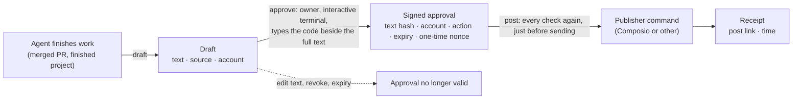

# LinkedIn drafts and approved posting

Issue #27, part of epic #17. An agent drafts a post about finished work. Only the owner can approve it, and only the exact approved text can be posted, once, to the approved account. `scripts/linkedin_post.py` enforces this. Composio (or another provider) is just the delivery step the owner plugs in, and holds no authority.



## Commands

| Command | Who | What happens |
|---|---|---|
| `draft --text-file F --source URL` | The agent that finished the work | Saves the draft privately and prints its id and approval code |
| `list`, `show <draft>` | Anyone | Shows drafts, their state and any approval |
| `approve <draft> [--hours 24]` | **Owner only** | Shows the full text and account. The owner types the 8-character code to approve. The approval is signed with the Keychain key and lasts up to 7 days (24 hours by default). |
| `revoke <draft>` | Owner or agent | Removes the approval and burns its nonce, so a saved copy can't be put back |
| `post <draft> [--dry-run]` | Owner, or an agent the owner tells to post that draft | Checks everything again, records the attempt, publishes, then records the post link |
| `reconcile <draft> [--posted URL \| --not-posted]` | Owner | Resolves an uncertain attempt before any retry |

Drafts, approvals and receipts live in `~/.local/state/karen-os/linkedin/store.json`. The file is readable only by the owner and never goes into the repository. The Notion **LinkedIn drafts** database (#23) is the place to read drafts on the phone; it isn't synced yet, and its `State` column is never an approval.

## What `post` checks, every time

1. The draft exists and hasn't been posted.
2. No earlier attempt is still uncertain.
3. A signed approval exists, and its signature matches the Keychain key, so it can't be forged or altered.
4. The approval is for the action `linkedin.post`.
5. The SHA-256 of the current text equals the approved hash, so any edit after approval blocks it.
6. The approval's account equals the configured account.
7. The nonce hasn't been revoked or used.
8. The approval hasn't expired.

The attempt is saved as *uncertain* **before** the publisher runs. A crash, timeout or ambiguous reply therefore leaves the draft blocked until `reconcile` finds out whether the post exists. A definite failure (the publisher says it did not post) keeps the approval for a retry. A success burns the nonce, so the same approval can never post twice.

## Threat model

**It stops:**

- a drafting agent approving its own draft through any normal path. Agents run commands without an interactive terminal, and approval needs one plus the typed code.
- text changed after approval
- the wrong account
- old, revoked or reused approvals
- duplicate posts from blind retries
- scheduled or automatic posting

**It does not stop** a process running as the owner that fakes a terminal **and** reads the Keychain key. The second step is why the key is stored so that macOS asks the owner each time it is read (setup step 1). Click **Allow**, never **Always Allow**. A compromised Mac is out of scope. The store file is integrity-checked through the signature, not hidden.

## Setup (owner)

### 1. Approval key in the Keychain

This creates a random key that no app may read without asking:

```bash
security add-generic-password -s karen-os-approval -a karen-os -T "" -w "$(openssl rand -hex 32)"
```

Check it:

```bash
security find-generic-password -s karen-os-approval -a karen-os -w > /dev/null
```

macOS should show a permission dialog. Click **Allow**, not Always Allow. If no dialog appears, the gate relies on the terminal check alone. Say so in #39. To start over, run `security delete-generic-password -s karen-os-approval -a karen-os`. Doing so invalidates every existing approval, which is safe.

### 2. Verify the provider before connecting

Before connecting LinkedIn to Composio or anything else, record these in #39, without credentials:

- [ ] The exact tool or action that creates a member post, and that it can be allowlisted on its own (no other tools exposed).
- [ ] The OAuth scopes requested. Expect posting on the member's behalf only, with no messaging, connections or profile edits.
- [ ] Free-tier limits and any charges, and what data the provider stores.
- [ ] Whether LinkedIn's own API ("Share on LinkedIn") is a simpler path with fewer parties.
- [ ] A safe read-only identity check after connecting, to confirm the right account before any post.

### 3. Publisher command

The script never calls a provider directly. It runs the command in `~/.config/karen-os/linkedin.json` (outside the repository):

```json
{
  "account": "example-person",
  "publish_command": ["python3", "/path/to/your/publish_linkedin.py"],
  "find_command": ["python3", "/path/to/your/find_linkedin_post.py"]
}
```

**Contract:**

- `publish_command` gets `{"account": ..., "text": ...}` as JSON on stdin.
  - **Exit 0** with `{"id": ..., "url": ...}` on stdout means posted.
  - **Exit 75** means unsure whether it posted.
  - **Any other exit** means it did not post (reason on stderr).
  - A 60-second timeout counts as unsure.
- `find_command` gets the same input and prints the matching recent post as JSON, or `null`.
  - It's optional: without it, check LinkedIn by hand and run `reconcile <draft> --posted URL` or `--not-posted`.

Credentials stay with the provider or in the Keychain, never in this file.

### 4. First live post

Following the issue's order:

1. a safe identity check
2. a draft linked to real work, not posted
3. `post --dry-run`
4. the owner explicitly authorises **one** live post

Nothing in this repository connects an account or posts.

## For drafting agents

Draft when work is finished and worth sharing: a merged PR that completes something, or a finished project. Write in the owner's plain voice, link the public source, and leave out private details, other people's names without their consent, and anything not yet public. Save the draft with `draft`, then tell the owner it's waiting. Never run `approve`, never post without the owner's instruction for that draft, and never edit a draft after it is approved. Edit it before approval, or revoke and redraft.
