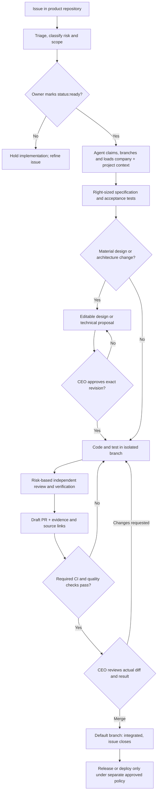

# KAREN OS: engineering organisation charter and delivery design

**Status:** Owner-discussed target architecture, proposed for formal acceptance in [epic #43](https://github.com/AbhiramYanamandra/karen-os/issues/43). This document captures the owner's intended operating model as a durable, standalone source for future Claude Code, Codex, ChatGPT and other agent sessions. It is **not** evidence that all mechanisms are implemented, nor an amendment to the existing pinned policies before this PR is approved.

**Relationship to the original vision:** This is a focused elaboration of KAREN OS's personal-first AI organisation, not a replacement. KAREN OS still supports direct work, optional chief-of-staff/personal operations, independent repositories, zero extra spend and accountable supervised autonomy. The source of overarching product vision remains [owner vision](../vision.md) and [platform architecture](architecture/platform-specification.md). The governing *current* engineering rules remain [engineering.md](organisation/engineering.md), [SOPs](organisation/sops.md), [policy](organisation/policy.md) and [execution contract](organisation/execution-contract.md) until separately approved changes are merged.

## The intended organisational model

**The owner is CEO. Agents are engineers/employees. KAREN OS is the organisation.** It sets company-wide engineering fundamentals, working practices, design standards, supported skills and tools, approval boundaries, accountability and quality gates. Claude Code, Codex and other compatible agents perform actual implementation within the appropriate independent project repositories. Muse or another chief of staff is optional, never a mandatory route into the system.

This is **organisational governance + decentralised execution + enforceable accountability**, not either of the extremes:
- **Not a passive wiki:** instructions alone do not guarantee compliance. Objective standards should become tests, lint rules, PR checks, branch protections and evidence requirements; subjective standards need meaningful review and owner decisions.
- **Not a central micromanager:** no always-running central LLM, obligatory chat with KAREN, generic multi-agent scheduler or new paid service is needed for ordinary engineering. The worker loads shared rules and project policy, chooses implementation tactics within those constraints and executes locally.
- **Not one rigid pipeline for every task:** the issue-to-branch-to-PR-to-CI-to-owner-merge lifecycle is stable for KAREN-managed engineering, while specification depth, visual approval, testing approach, security review and required skills vary by task type and risk.
- **Not a claim of perfect enforcement:** agents can deviate or falsely attest. KAREN must minimise unverified trust, independently check observable outcomes and disclose what cannot be proved. When something is missed, reject the PR, record the finding and improve the control.

### Responsibilities and decision rights

| Responsibility | CEO / owner | KAREN OS shared standards and tools | Project agent |
| --- | --- | --- | --- |
| Product strategy, priority, budget | Decides | Preserves policy and limits | Recommends, never broadens authority |
| Work intake | Approves actionable issue (`status:ready`) | Defines issue template, labels and triage practice | Creates scoped issue, proposes acceptance criteria |
| Technical/spec decisions | Approves material scope/design | Supplies standards and required gates | Investigates, compares approaches and proposes |
| Design system | Approves project identity and substantive revisions | Requires adherence and evidence; recommends reusable practices | Applies the **project's** tokens and patterns |
| Skills | Approves trusted additions/exemptions | Registry, triggers, provenance, versions, loading rules | Selects applicable extras and loads required ones |
| Implementation | Delegates scope | Issue, branch, PR, CI and verification guardrails | Builds in the project checkout and self-tests |
| Independent review | Reviews risks and final artefacts | Defines review depth and evidence | Performs or requests separate review and fixes findings |
| Merge, release, production or posting | Explicit owner authority | Enforces gates where tools allow | Never silently merges, deploys or publishes |
| Accountability | Rejects/requests changes | Records blocked gates, exceptions, evidence and lessons | Reports failures and unknowns honestly |

Repository policy can make a company standard stricter; it cannot waive company authority or security policy. **Every rule must identify whether it is mandatory, an engineering default, or optional guidance.** Narrow exceptions must be owner-approved, attributable, scoped and recorded, never invented by the worker.

## Company-grade lifecycle: issue to verified delivery

A worker must load the **reviewed compact KAREN engineering standard** derived from the [Microsoft Code-With Engineering Playbook](https://microsoft.github.io/code-with-engineering-playbook/), along with project rules. It should retrieve applicable original playbook chapters/checklists when useful, not download/read the entire external playbook at every startup. Versions and links matter; external guidance must not override owner policy.

1. **Issue and authorisation:** every managed engineering change, including a small fix, starts with a ticket in that product repository. Use the current `status:ready` rule. Exploration and non-actionable discussion need no ticket. GitHub Projects is only a view, not an authorisation signal.
2. **Claim / branch:** use the existing one-worker-per-issue pipeline and a feature branch. The agent cannot push to `main`. Check existing ownership, prior work and dependencies.
3. **Specify:** understand current behaviour, requested outcome, constraints, out-of-scope, risk, acceptance criteria, rollback and what verification would demonstrate success. Prefer a short issue comment for a small fix; use a revisioned proposal for substantial change.
4. **Design:** for material UI/UX work, use an approved design workflow (Figma editable layers plus UI/UX skill where compatible), showing actual device variants and states. For backend/security changes, use architecture/data flow, threat boundaries and alternatives instead. Approval binds to revision and scope; a material change returns to this gate. Minor existing-pattern changes need no invented heavyweight design step.
5. **Implement:** load mandatory coding skills for the stage, plus relevant project/language practices. Work against the approved scope and design. Testing starts during implementation, not as a post-hoc checkbox.
6. **Verify / review:** project tests, lint/style rules, security checks and independent or separately identified review appropriate to risk. A self-review is not an independent review. Test success must be based on actual recorded execution and results.
7. **PR / CI:** one traceable PR per issue, linking exact design approval, tests, reviewer findings, outstanding checks, risk and rollback. Required checks block merge; GitHub settings must be verified per repository. A passed PR-metadata check does not mean all project quality standards are enforced.
8. **CEO merge / delivery:** only the owner merges. A merge does **not** automatically authorise deployment, external messaging, production operations, hardware writes or payment. Post-merge cleanup and honest status updates follow existing rules.

## Worked example A: LookAtMe styling feature

An issue asks to redesign a homepage or add a dialog. The company standard requires the ticket/branch/PR process; LookAtMe's standards define typography, tokens, accessibility, responsiveness and component conventions. A major visual redesign triggers:
- **Intake/spec:** investigate current UI, identify untouched functionality, propose measurable acceptance criteria.
- **Design:** load approved UI/UX and Figma skills, provide a link to an editable revision with desktop/mobile, focus/hover/error states where relevant. Get owner approval of the exact design. Figma integration must be tested in the agent's runtime; an image alone is not editable design.
- **Implementation:** approved Ponytail guidance for applicable code work, framework conventions, appropriate TDD/behaviour tests; preserve existing approved design tokens.
- **Verification:** run automated style lint, accessibility and behavioural checks; perform visual comparison and meaningful independent code review. The approved thermonuclear review skill is required for the **defined substantial/high-impact review profile**, not every documentation edit.
- **Delivery:** complete PR, CI, owner's visual review and owner's merge. If company-approved typography is Helvetica but an agent uses Times New Roman, a project style/token check should fail and a visual/reviewer gate should also catch the mismatch. **This is an example, not a declaration that LookAtMe currently uses Helvetica or that such checks exist.**

## Worked example B: LinkedIn writing

When an agent drafts a LinkedIn post about verified finished work, the **approved Unslop** skill is a mandatory drafting/revision stage (subject to installation/version validation). The agent checks source-backed claims, tone and privacy. If the skill is missing, report this and do not represent the draft as compliant; request approval for an alternative if needed. The owner then reviews the *exact* final text. Existing `scripts/linkedin_post.py` binds the posting approval to that text/account/action/expiry with duplicate-safe reconciliation. A Notion status, a drafting skill or a PR merge alone can never authorise posting. Composio is an optional scoped delivery provider, not an approval authority.

## Skill standards: requirements, execution and discovery

A **skill** is a versioned set of instructions, assets, optional scripts and dependencies, not proof of competence. KAREN OS stores reviewed metadata in a shared catalogue; a project agent selects and invokes it at the **relevant lifecycle stage**. Mandatory use must not be left to the agent's whim; optional additional skills are the agent's judgement.

| Trigger / work stage | Target rule | Evidence and limits |
| --- | --- | --- |
| All managed engineering | Reviewed KAREN fundamentals and project instructions **required** | Startup policy hash and reading evidence; current baseline already implemented |
| Coding stage | Approved Ponytail guidance **required for applicable implementation** | Version/availability checks and PR disclosure; not approved or registered yet |
| Substantial UI design | Approved UI/UX Pro + Figma workflow **required when available and validated** | Editable revision and owner approval; unavailable skill/tool holds design-required work or seeks authorised alternative |
| Substantial/high-impact code review | Approved thermonuclear review **required under specified risk profile** | Separate findings and fixes; skill instructions must be audited first |
| LinkedIn writing | Approved Unslop **required** before owner text approval | Loaded version and edited draft; final editorial and factual check separate |
| Bugs and tests | Approved diagnosing-bugs/TDD/verification **selected by task** | Reproduction, regression evidence, tests and limitations |
| Security-sensitive work | Risk-appropriate secure engineering and security testing **required** | Threats, checks and documented findings; no unapproved external scans |

Names above are **owner preferences to be operationalised**, not claims of existing approved skill versions. The current `docs/organisation/skills.json` registry has `entries: []`. The provided local inventory lists many shared, Claude and Codex paths, but file names alone cannot establish the contents, licensing or equivalence of these installs.

**Proposed states:** discovered → under review → approved/pinned → installed/available → selected/loaded → verified in task → retired/revoked. Installed is not necessarily approved; a registered skill is not necessarily installed in a particular runtime; a named skill is not proof it was followed.

**Capability discovery:** a project agent encountering unfamiliar work identifies the gap and searches trusted docs and candidate skills (existing local `find-skills` is a candidate). It must inspect the *entire* skill package including bundled scripts, command behaviour, licences, dependencies, external endpoints, provenance, permissions, secrets and prompt-injection risk. It records a source ref and immutable reviewed version/hash, suggests safe alternatives and requests owner authorisation before installing, activating or granting new permissions. Test in isolation; no skill can expand its own authority. If a required capability is missing, hold the affected stage and report; if only a suggested skill is missing, continue using authoritative docs and the approved baseline while disclosing the gap. No blind auto-install and no paid fallbacks.

**Efficient loading:** always load compact core guidance, then stage-specific metadata and bodies **only when triggered**; do not stuff the entire playbook or hundreds of `SKILL.md` files into context. Avoid redundant skills with the same purpose; use selective exception handling and measure time/context overhead.

## How the organisation enforces standards

A real company does not rely on engineers voluntarily following every convention. Failure should be **detected, reviewable and consequential to delivery**:

| Standard | Enforceable mechanism | Cannot honestly prove automatically |
| --- | --- | --- |
| Issue, branch, PR, required checks | GitHub rulesets and pipeline/PR CI | The issue fully captures user intent |
| Approved tokens/fonts and source rules | Project lint/style assertions and component tests | Every visual choice looks good |
| Design approval | Revision-linked approval record + PR validator | A screenshot matches intent without visual review |
| Skill policy | Registry version check, runtime load receipt, PR evidence | That model *actually obeyed* all skill prose |
| Functional correctness | Behaviour and regression tests, realistic test environment | Absence of all bugs |
| Security baseline | Threat assessment, SAST/dependency tests where configured | Complete security or absence of exploits |
| Review | Reviewed PR evidence and findings, distinct reviewer where required | Independent judgement from a self-attestation |
| Merge/release | Required checks, protected branch, owner decision | Guaranteed protection if the GitHub plan/configuration cannot enforce it |

**Escalation:** failing checks block readiness/merge; unexplained deviations request changes; policy exceptions need a scoped owner decision and auditable note; repeated failures lead to improving the instructions/checks/skills rather than inventing agent punishment. A worker may report a violation, but must not quietly mark it as done. Keep severity proportional and measure impact before adding new process.

**Limits:** when agents authenticate to GitHub as the owner, GitHub may not technically distinguish human and agent actions. Branch protections and human review improve controls but cannot establish who clicked merge. Some private repositories/plans lack required branch rulesets. Clearly mark such enforcement as **procedural, not technically guaranteed**, and investigate separate identities/permissions only with explicit owner approval. Do not claim tests, skills or permissions exist merely because they appear in this charter.

## Implementation plan (separate bounded PRs)

The charter itself is **PR 0 / design gate**, not an implementation claim. Follow-on issues and PRs should each close one concrete slice and avoid changing unrelated daily-review work:

1. **PR A — skill inventory and trusted catalogue:** read actual installed skill files safely; compare aliases/duplicates/compatibility and Ponytail, Unslop, Figma, TDD, code-review, thermonuclear, security candidates; record provenance, risks, owner approvals and targeted minimum set.
2. **PR B — lifecycle profiles and stage resolution:** machine-readable schema for issue type/risk/stage, mandatory vs recommended skills, applicability and missing-skill handling; deterministic validation and tests; no central AI router required.
3. **PR C — project integration and enforceable gates:** extend existing startup/pipeline/PR checks carefully, validate design-approval references, skill-load receipts and project lint/testing hooks; require checks in a product repo only after they work there. Never claim skill prose is machine-verifiable.
4. **PR D — secure discovery and onboarding:** safe candidate review, pinning/version updates, quarantine/revocation, compatibility checks and simulated malicious/incompatible skill tests, with owner approvals.
5. **PR E — LookAtMe pilot and rollout:** a real design-first feature through issue → approved Figma revision → code → tests/review → PR/CI → owner merge; deliberate wrong-font and skipped-skill negative tests; compare quality, token overhead, elapsed time and owner interventions. Use a dedicated issue and PR **in LookAtMe** for product changes, not in the KAREN OS monorepo.

**Sequence dependencies:** the owner approves this charter before changing mandatory core rules; catalogue and profiles before enforcement; enforcement before claiming a compliant pilot. Improvements to #26 usage-aware dispatch consume these contracts later, not the other way round. #17 personal daily-review remains separately planned.

## Acceptance and drift checks for future sessions

Before implementing follow-on slices, each new agent should:
1. Read this charter **entirely**, along with current `AGENTS.md`, engineering standard, relevant project rules and the **assigned issue**. Reconcile newer explicit owner directions rather than inferring approval from a merged document.
2. Identify which statements above are **owner vision**, **approved policy**, **proposed design**, **implemented verified behaviour**, or **unverified account-dependent capability**.
3. State the precise PR slice, risk, expected skills, current source revisions and available tools. Do not replace the organisation with a central mandatory AI service, nor degrade it to optional advice.
4. Preserve personal-first, direct project-agent workflows, owner design/merge/posting approvals, project autonomy, zero incremental spend and privacy.
5. Demonstrate actual enforcement where possible; never treat a checklist or a claimed skill invocation as sufficient proof.
6. If a current document contradicts this charter, stop on the conflicting action and request an owner decision, rather than silently reinterpreting it. Do not alter hash-pinned policies or the old architecture document without separately reviewed repinning.

**Project-specific and personal constraints:** this is a public specification. Real device details, private paths, account data, personal credentials, drafts and private records must not be committed. The owner's local skills can be referenced by public names but not copied into this repo without a licence/source review.

**Definition of success:** an engineer receives a scoped issue in an independent repo and reliably delivers work conforming to KAREN **and project** standards, with missed objective rules causing failed checks and subjective issues receiving review; the owner approves consequential design revisions and controls merge/release, without having to repeat skill names or manually orchestrate every step.
