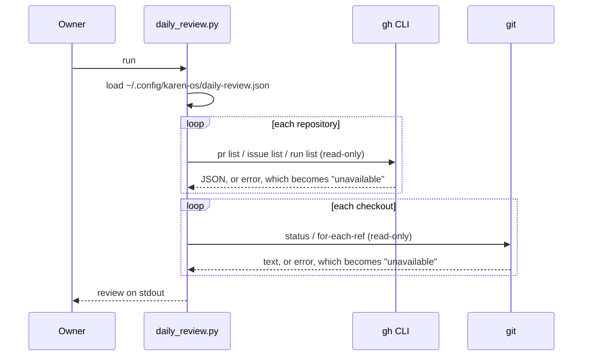

# Proposal: daily review command

Revision 1, 23 November 2026. Issue #17. Status: **awaiting owner approval**. Change type: backend (specification section 11).

## Summary

A read-only local command, `python3 -B scripts/daily_review.py`, prints one plain-text review covering the configured GitHub repositories and local checkouts: what merged, what needs the owner, what an agent could take next, failing CI on default branches, and local Git state. It reads GitHub through the `gh` CLI the owner already has signed in, and local state through `git`. It writes nothing, stores nothing, costs nothing, and labels any source it cannot read as unavailable. The list of repositories and checkouts lives in a personal config file outside this repository.

## Decisions needed

Each has a recommendation. Approving the proposal as written accepts all of them.

| # | Decision | Recommendation | Alternative |
|---|---|---|---|
| R1 | How to read GitHub | `gh` CLI via `subprocess`. Auth, tokens and rate limits stay in `gh`. No token handling in our code. | REST API via `urllib` with a token from an environment variable. No `gh` dependency, but our code then handles a credential. |
| R2 | Where the config lives | `~/.config/karen-os/daily-review.json` (or `$XDG_CONFIG_HOME`), overridable with `--config`. JSON, because `tomllib` is missing on Python 3.10, which CI tests. | A file in the KAREN OS checkout, ignored by git. Easier to find, easier to commit by accident. |
| R3 | Default time window | Last 24 hours, with `--since 3d` for Mondays or after a break. | "Since last run". Needs a state file, so it is no longer stateless. |
| R4 | Local Git freshness | No `git fetch`. Local state is shown "as of last fetch", with that fetch's age. Strictly read-only. | An opt-in `--fetch`. Updates remote-tracking refs, which counts as a repository change. |
| R5 | Exit codes | `0` all sources read, `3` review printed but some sources unavailable, `2` config or usage error. | Always `0` when anything printed. |

## Sections and sources

Every section header names its source, for example `Merged in the last 24h (GitHub via gh)`.

| Section | Source | Query |
|---|---|---|
| Merged recently | GitHub | `gh pr list -R <repo> --state merged --search "merged:>=<date>" --json number,title,mergedAt,url` |
| Waiting for review | GitHub | `gh pr list -R <repo> --state open --json number,title,isDraft,createdAt,url,statusCheckRollup`. Non-draft PRs are listed with their check state. Drafts are counted as in progress. |
| Needs the owner | GitHub | `gh issue list -R <repo> --label status:needs-owner` and `--label status:blocked` |
| Ready for an agent | GitHub | `gh issue list -R <repo> --label status:ready`, sorted `P0` to `P3`, then oldest first, matching the engineering standard's pick order |
| Failing CI | GitHub | `gh repo view --json defaultBranchRef`, then `gh run list -R <repo> --branch <default> --json workflowName,conclusion,createdAt,url`. Shows the latest run per workflow if it failed. |
| Local Git | `git` | `git status --porcelain=v1 --branch` (uncommitted, ahead or behind) and `git for-each-ref refs/heads` (unpushed branches, branches whose upstream is gone, branches idle for over 14 days) |

All queries above were run against this repository on 23 November 2026 and returned the expected fields.

## Command and options

```
python3 -B scripts/daily_review.py [--config PATH] [--since 24h|3d|YYYY-MM-DD]
                                   [--repo OWNER/NAME ...] [--format text|json]
```

- `--repo` limits a run to some configured repositories.
- `--format json` produces the same data as JSON, for a later briefing feature (D06 stays pending, so nothing consumes it yet).

Config example (synthetic):

```json
{
  "repositories": ["example-owner/alpha", "example-owner/beta"],
  "checkouts": ["~/code/alpha", "~/code/beta"],
  "stale_branch_days": 14
}
```

## Architecture

One script with four small parts, standard library only:

1. **Config**: loads and validates the JSON. Missing file means exit `2` with a message showing where it looked and a sample.
2. **Sources**: `GitHubSource` and `GitSource`. Each calls an injected `run(argv) -> (code, stdout, stderr)` function, so tests replace it with fixtures. Each returns a `Section` with `items`, `source`, and either `ok` or `unavailable: <reason>`.
3. **Review**: builds the ordered list of sections.
4. **Render**: text (default) or JSON.



## Failure handling

| Failure | Result |
|---|---|
| `gh` not installed or not signed in | Every GitHub section is unavailable, with the reason. Git sections still run. |
| One repository not found, no access, rate-limited or network down | That repository's rows are unavailable. Others still show. |
| Checkout path missing or not a Git repository | That checkout is unavailable. |
| Unexpected JSON shape | That section is unavailable with "unexpected response". Never a partial guess. |
| Bad config | Exit `2` before any query runs. |

Each external call has a 20-second timeout. The script never retries in a loop.

## Privacy and permissions

- Read-only by construction: only `gh ... list`, `gh repo view`, `gh run list`, `git status` and `git for-each-ref`. Tests assert that no other subcommands are called.
- Output goes to stdout only. No cache, log or state file.
- The personal config stays outside the public repository. Committed fixtures use synthetic names (`example-owner/alpha`).
- Network traffic goes only to GitHub, using the owner's existing `gh` session. No model calls and no paid services.

## Tests

- `tests/test_daily_review.py`, using `unittest`.
- Recorded `gh` JSON responses in `tests/fixtures/daily_review/`, sanitised to synthetic names, served by a fake `run`.
- Git parsing tested against recorded porcelain output. One test builds a temporary local repository with `git`, with no network access.
- Cases: every section populated, every section empty, `gh` missing, one repository failing, malformed JSON, missing config, priority sort order, `--since` parsing, and the allow-list of read-only commands.
- CI is unchanged. The existing `unittest discover` picks the tests up and needs no network or credentials.

## Rollout and rollback

- Rollout: one implementation PR (script, tests, fixtures, README section), expected to be under 400 lines excluding fixtures.
- Rollback: revert that PR. The command stores no state and changes nothing, so there is nothing to migrate or clean up. The personal config file can stay or be deleted.

## Out of scope

Scheduling, notifications, email or chat briefings, dashboards (D06), any GitHub write, paid or model calls, and a private instance store (D08). Detecting stale `status:in-progress` claims that have no PR could be a later issue.
