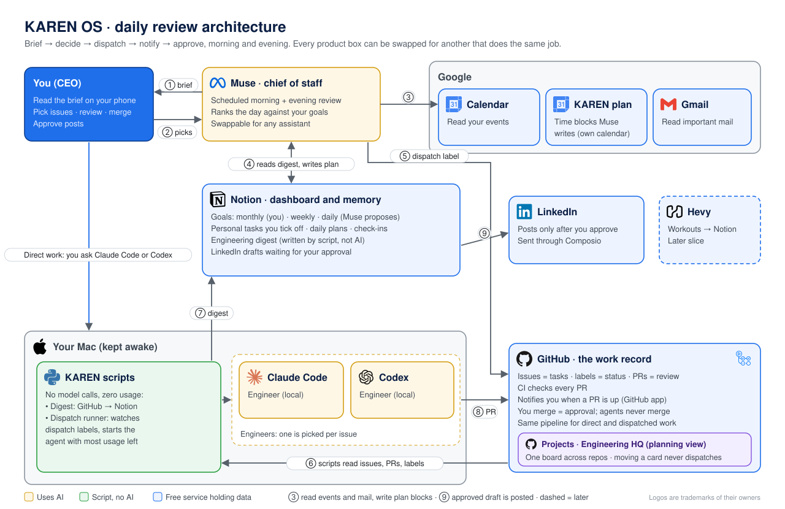
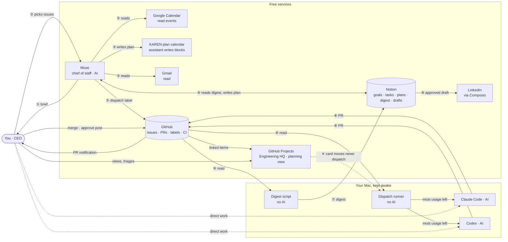
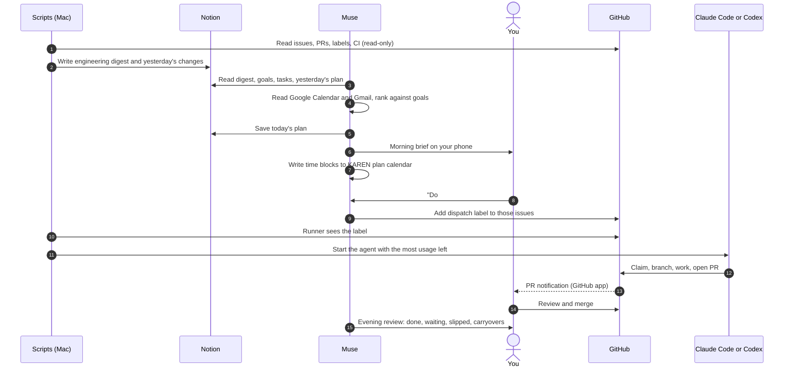
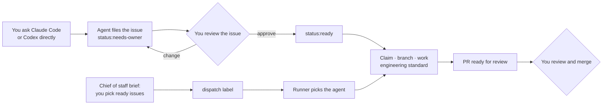

# Proposal: the daily review

Revision 3, 23 November 2026. Epic #17, sub-issues #23 to #28. Status: **awaiting owner approval** (merging PR #20 approves this revision). Change type: backend and integration (specification section 11).

## Summary

The daily review is KAREN OS's first personal feature. It's a loop the owner runs twice a day from their phone:

**brief → decide → dispatch → notify → approve.**

Every morning the owner's assistant (Muse today) sends a briefing and turns it into a time-blocked plan on a separate "KAREN plan" Google Calendar. The briefing covers:
- what got done yesterday and what slipped
- today's calendar and important email
- across every project: what's waiting for the owner, what hit problems, and the most important issues to start
- everything ranked against the owner's goals

The owner then picks issues. Each one goes to whichever local agent, Claude Code or Codex, has the most usage left. The agent works through the normal issue-to-PR pipeline, the owner is notified when the PR is up, and the owner reviews and merges. The evening review closes the loop and carries leftovers into tomorrow.

The design follows four rules:

1. **Scripts collect facts. AI only makes judgement calls.** Usage stays small.
2. **Every product can be swapped.** Muse, Notion, Claude Code, Codex and Composio each do one replaceable job. KAREN OS owns the rules, prompts, scripts and records.
3. **Zero additional spend.** Everything runs on free plans or subscriptions the owner already has.
4. **The owner stays in charge.** Nothing merges, publishes or posts without the owner. Direct work with an agent works exactly as before.

This revision replaces revision 2, a prompt-only review, and revision 1, a GitHub-only script. Those are commits `a24b2fd` and `54fb7c5` on this branch. The owner's feedback on PR #20 changed the scope.

## Architecture

The same architecture as editable text (Mermaid is the canonical diagram format, ADR10):

[KAREN OS | Engineering HQ](https://github.com/users/AbhiramYanamandra/projects/1) is the GitHub Project that shows issues and PRs from every connected repository on one board ([design](../architecture/github-projects.md), issue #29). The owner and the assistant can use it to see and plan work. It authorises nothing: the dispatch runner acts only on a `dispatch` label on a `status:ready` issue, and moving a card never starts an agent. The digest (#24) reads GitHub directly, so the review works even if the board is unavailable.

## One day

## Two ways work starts, one pipeline

Not everything goes through the chief of staff. When the owner opens Claude Code or Codex and asks for something directly, the agent follows the same KAREN OS rules:

- **Direct:** the agent writes the issue first and stops. It only starts once the owner marks the issue `status:ready`. Then it claims the issue, creates a `<type>/<issue>-<short-description>` branch, does the work and opens a PR for review. This is the existing engineering standard. This revision makes the "issue first" step explicit in `docs/organisation/engineering.md`.
- **Dispatched:** the owner picks issues that are already `status:ready` from the brief, and the runner starts an agent on them.
- **Both** show up in the next brief, because GitHub is the single record.

## Script or AI

| Piece | Done by | Why |
|---|---|---|
| GitHub status: PRs waiting, blocked, needs-owner, ready, failing CI, changes since the last digest | Script (#24) | Facts |
| Personal tasks ticked off | Script reads Notion | Facts |
| Free time in the calendar | Assistant | It already reads the calendar, so no extra Google setup |
| Which emails matter | AI (assistant) | Judgement |
| Ranking the day and building the time-blocked plan | AI (assistant) | Judgement, starting from rule-based order: goals, deadlines, `P0`–`P3` |
| Writing plan blocks to the KAREN plan calendar | Assistant | Mechanical, through its calendar connector |
| Weekly goals on Sunday, daily goals each morning | AI (assistant) | Judgement; the owner sets monthly goals and adjusts |
| Evening check-in (meals, sleep, what got done) | AI (assistant) | Short conversation |
| Dispatch: watch labels, read usage, start an agent | Script (#26) | Rules |
| Claim, branch, open PR, move labels | Script (#21) | Rules |
| PR checklist | CI (#22) | Rules |
| The engineering work | AI (Claude Code or Codex) | The real work, and most of the usage |
| LinkedIn draft | AI, small | The agent that finished the work already has the context |
| LinkedIn post after approval | Script via Composio (#27) | Mechanical |
| PR notifications | GitHub app | Built in |

## Notion data model (#23)

Notion holds the personal layer, the private instance from decision D08, on the owner's free plan. The repository documents only the generic shape; the owner's content stays in Notion.

| Database | Key properties | Written by |
|---|---|---|
| Goals | Title, level (month, week, day), period, status, parent goal | Owner (monthly); assistant proposes weekly and daily goals for the owner to adjust |
| Tasks | Title, goal, due, status, source (personal or GitHub issue link) | Owner and assistant |
| Daily plans | Date, morning plan, evening review, carryovers, check-in notes | Assistant |
| Engineering digest | Date, repository, section, item, link, observed at | Digest script only |
| LinkedIn drafts | Text, source PR or project, status (Draft, Approved, Posted), post link | Agent drafts; owner approves; script posts |

## Authority

| Action | Rule |
|---|---|
| Write, move or delete events on the KAREN plan calendar | **New standing authority** for the owner's assistant, no per-event approval. Only that calendar; the owner's main calendar is never changed. |
| Read calendar, email, Notion and GitHub | Allowed for the assistant the owner has connected |
| Add the `dispatch` label | The owner, or the assistant on the owner's word in that conversation |
| Start an agent on a dispatched issue | Runner, for `dispatch` + `status:ready` issues only |
| Move cards on the Engineering HQ board | Anyone with access. It authorises nothing; the runner never reads card positions |
| Push branches, open PRs, update issue labels | Existing standing authority (engineering standard) |
| Merge, release, close issues | Owner only, unchanged |
| Publish to LinkedIn | Owner approves each post in Notion; nothing is posted automatically |
| Send email or reply for the owner | Not allowed |
| Paid fallback of any kind | Not allowed |

## Dispatch (#26, depends on #21)

1. **Spike first.** Find how to read remaining session and weekly usage from Claude Code and Codex in a form a script can use. Label each observation *reported*, *estimated* or *unknown*, with its age.
2. **Selection.** Pick the agent with the larger remaining share. If usage is unknown or both are low, **hold and report** in the next brief. Never fall back to a paid API.
3. **Run.** Start `claude -p` or `codex exec` headless, in its own worktree, with the issue as the task. Claim and PR steps use the pipeline script (#21). One worker per issue.

**Why not OmniRoute (decision D12):** it switches models one request at a time, falls back to paid APIs, and handles subscription sign-ins. The owner needs a per-task choice of agent with no paid fallback, which a small KAREN OS script does.

## Products, cost and how to swap them

| Job | Product today | Plan | Swap for |
|---|---|---|---|
| Chief of staff (briefs, plans, goals) | Muse | Free | Any assistant that reaches Notion, Google and GitHub |
| Dashboard and personal memory | Notion | Free personal plan | Another store with an API and phone app |
| Calendar and email | Google Calendar, Gmail | Free | Any calendar or mail the assistant can reach |
| Work record and notifications | GitHub | Free (public repositories) | — |
| Engineers | Claude Code, Codex (local) | Existing subscriptions | Any local coding agent with a headless mode |
| LinkedIn posting | Composio (LinkedIn only) | Free tier | LinkedIn's own API |
| Scripts | Python standard library | Free | — |

The only real usage is the engineering work, and the owner controls it by choosing what to dispatch. Notion AI, Notion Custom Agents and paid assistant plans are not used.

## Failure handling

| Failure | Result |
|---|---|
| A source can't be read | That section says unavailable, with the last known state and its age. Never guessed. |
| Digest script didn't run (Mac asleep, error) | The brief says the digest is stale and how old it is |
| Usage unknown | Dispatch holds and reports; nothing starts |
| Agent fails mid-issue | The issue gets `status:blocked` with a comment; the next brief shows it under "needs you" |
| Assistant replaced | The same prompt templates (#25) go to the new assistant; data stays in Notion and GitHub |
| A post isn't approved | It stays a draft |

## Privacy

- The public repository holds only generic docs, prompt templates, scripts, synthetic fixtures and diagrams.
- Goals, tasks, plans, check-ins, digests and drafts live in the owner's Notion. Calendar and email stay in Google. Tokens stay in the Keychain or environment, never in Git.
- The owner has connected Muse to Notion, Google Calendar, Gmail and GitHub, and chose Composio for LinkedIn. Those connections are the owner's consent for these destinations. Health data stays limited to what the owner reports, until #28.

## Delivery plan

| Order | Issue | Slice |
|---|---|---|
| 0 | #20 | This proposal (design gate) |
| 1 | #22, #21 | CI checks PR metadata; pipeline script (already `P1`) |
| 2 | #23 | Notion workspace and data model |
| 3 | #24 | Engineering digest script |
| 4 | #25 | Briefing prompts, KAREN plan calendar, Muse trial |
| 5 | #26 | Usage-aware dispatch (spike first) |
| 6 | #27 | LinkedIn drafts and approved posting |
| later | #28 | Hevy workouts |

Each slice is its own issue and PR, and the owner merges each one. After this proposal merges, slices #23 to #27 move from `status:blocked` to `status:ready`.

## Open questions resolved by the slices

1. How Claude Code and Codex expose remaining usage to a script (#26, the spike).
2. Muse's limits in practice: schedule times, calendar write permission, and how it handles the digest page (#25, the trial).
3. Notion free-plan API limits for the digest (#24).

## Rollback

Every slice is reversible on its own: stop the `launchd` job, remove the `dispatch` label, hide the KAREN plan calendar, archive the Notion pages, or revert the PR. No slice changes the owner's main calendar, sends anything, or merges anything.

## Out of scope

- Always-on servers and cloud agents.
- Sending email.
- Changing the owner's main calendar.
- Paid plans or paid fallback.
- Health advice.
- A KAREN OS app or custom dashboard (Notion is the dashboard).
